# Compiler & Interpreter

> [!info] Lecture — 2026-09-28
> CS310 Programming Languages & Compiler

## Compiler vs Interpreter

| | Compiler | Interpreter |
|---|---|---|
| **How it works** | Translates entire program before running | Checks line by line, stops at first error |
| **Output** | Machine code (executable) | Runs directly, no output file |
| **Speed** | Fast execution (pre-compiled) | Slower (interprets on the fly) |
| **Error reporting** | Reports all errors at once | Stops at first error |
| **Example** | GCC (C), javac (Java) | Python, Ruby, JavaScript |

## Phases of a Compiler

```mermaid
graph LR
    A[Character Stream] --> B[Lexical Analysis]
    B --> C[Token Stream]
    C --> D[Syntax Analyser]
    D --> E[Semantic Analyser]
    E --> F[Syntax Tree]
    F --> G[Intermediate Code Gen]
    G --> H[Machine-Independent Optimiser]
    H --> I[Target Code Gen]
    I --> J[Machine-Dependent Optimiser]
    J --> K[Target Machine Code]
    
    style B fill:#ff9,stroke:#333
    style D fill:#f9f,stroke:#333
    style E fill:#9ff,stroke:#333
```



```
Character Stream
      │
      ▼
┌─────────────────┐
│ Lexical Analysis │  ← Phase 1
└────────┬────────┘
         │ Token Stream
         ▼
┌─────────────────┐
│ Syntax Analyser  │  ← Phase 2
└────────┬────────┘
         │ Parse Tree
         ▼
┌─────────────────┐
│Semantic Analyser │  ← Phase 3
└────────┬────────┘
         │ Annotated Tree
         ▼
┌─────────────────┐
│ Intermediate     │  ← Phase 4
│ Code Generation  │
└────────┬────────┘
         │ IR
         ▼
┌─────────────────┐
│ Code Optimiser   │  ← Phase 5
└────────┬────────┘
         │ Optimised IR
         ▼
┌─────────────────┐
│ Target Code Gen  │  ← Phase 6
└─────────────────┘
```

**Analysis** (front end) → **Synthesis** (back end)

---

## Phase 1: Lexical Analysis

The **lexer** (scanner/tokenizer) reads the raw source code character by character and groups them into meaningful units called **tokens**.

**Input**: raw characters → **Output**: token stream

### What is a Token?

A token is a classified unit of meaning:

| Token Type | Example |
|---|---|
| **Keyword** | `if`, `else`, `while`, `return` |
| **Identifier** | `x`, `main`, `ptr` |
| **Number** | `42`, `3.14` |
| **Operator** | `+`, `=`, `>`, `==` |
| **Delimiter** | `;`, `{`, `}`, `(`, `)` |
| **String literal** | `"hello"` |
| **Comment** | `//...` or `/*...*/` (ignored) |

### Example — C String Declaration

```c
//create a string in C.
const char* ptr="this is a string";
```

The lexer scans this and produces:

| name | type | line |
|---|---|---|
| `const char` | keyword | 2 |
| `*` | pointer | 2 |
| `ptr` | identifier | 2 |
| `=` | operator | 2 |
| `"this is a string"` | characters | 2 |
| `;` | delimiter | 2 |

> [!note] What gets ignored
> - Comments (`//create a string in C.`)
> - Whitespace (spaces, tabs, newlines)

### How `char*` Works in C

```c
const char* ptr = "this is a string";
```

- `"this is a string"` is a **string literal** — stored in memory as a sequence of characters
- `char* ptr` means "ptr is a pointer to a char" — it holds the **memory address** of the first character
- `const` means you can't modify the string through this pointer

```
ptr                  → 0x7fff5a2b  (address of 't')
                        ↓
Memory:  't' 'h' 'i' 's'  ' '  'i' 's'  ' '  'a'  ' '  's' 't' 'r' 'i' 'n' 'g' '\0'
         ↑
         ptr points here
```

- `ptr[0]` = `'t'`, `ptr[1]` = `'h'`, etc. — pointer arithmetic walks through characters
- The `*` in `char*` is part of the type declaration, not dereferencing

### Token Example — Full Expression

```c
if (x > 5) { return x; }
```

| Token    | Type       |
| -------- | ---------- |
| `if`     | keyword    |
| `(`      | delimiter  |
| `x`      | identifier |
| `>`      | operator   |
| `5`      | number     |
| `)`      | delimiter  |
| `{`      | delimiter  |
| `return` | keyword    |
| `x`      | identifier |
| `;`      | delimiter  |
| `}`      | delimiter  |

> [!tip] Why lexical analysis matters
> The lexer simplifies the parser's job — instead of dealing with individual characters, the parser works with meaningful tokens. This separation of concerns makes compilers modular and easier to build.

---

> [!tip] Next lecture
> Fill in the `next` field in frontmatter once the next notes arrive.
