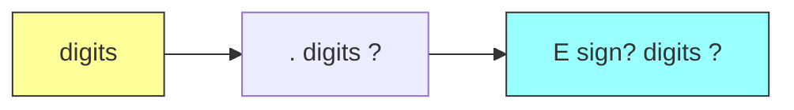

# Regular Expressions

> [!info] Lecture — 2026-10-05
> CS310 Programming Languages & Compiler — Week 2, Lectures 1 & 2
> Lecturer: Edgar Galván López · Source: `2026_CS310_Notes.pdf`

## Strings & Languages

A **language** is a set of strings over an **alphabet** $\Sigma$. Let:

- $L$ = the set of all **letters** ($52$ = $26$ lowercase $+ 26$ uppercase)
- $D$ = the set of all **digits** ($10$)

Then the common string sets used to define a lexer's tokens are:

| Expression | Meaning | Size |
|---|---|---|
| $L \cup D$ | one letter **or** one digit | $52 + 10 = 62$ strings of length 1 |
| $LD$ | one letter **followed by** one digit | $52 \times 10 = 520$ strings of length 2 |
| $L^4$ | any 4-letter string | $52^4$ strings of length 4 |
| $L\,(L \cup D)^*$ | a string beginning with a letter, then any letters/digits | identifiers |
| $L^*$ | any string of letters, **including the empty string** $\epsilon$ | — |
| $D^+$ | one or more digits | — |

> [!note] Read left to right
> $LD$ means "an $L$ **then** a $D$" (concatenation). $L\,(L\cup D)^*$ is exactly the definition of an **identifier**: it must start with a letter, and may continue with letters or digits.

## Regular expressions & shorthand notation

A **regular expression** is a notation for describing a language (a set of strings) compactly. The lexer's token patterns from [[2026-09-22 - Compiler & Interpreter]] are written as regular expressions.

| Operator | Meaning |
|---|---|
| `a \| b` | union (alternation) — either `a` or `b` |
| `ab` | concatenation — `a` followed by `b` |
| `a*` | Kleene star — zero or more `a` |
| `a+` | positive closure — one or more `a` |
| `a?` | optional — zero or one `a` |
| `[abc]` | character class — any one of `a`, `b`, `c` |

### Shorthand for the alphabet

The full enumeration of a letter:

```
letter → A | B | C | … | Z | a | b | … | z | _
```

collapses to a **character class**:

```
letter → [A-Za-z_]
digit  → [0-9]
```

### A number token, step by step

```regex
digit  → [0-9]
digits → digit+
num    → digits (. digits)? (E [+-]? digits)?
```

Reading `num`:

| Part | Meaning |
|---|---|
| `digits` | the integer part (one or more digits) |
| `(. digits)?` | **optional** decimal fraction |
| `(E [+-]? digits)?` | **optional** exponent, e.g. `E-3`, `E+2` |

So `num` matches `42`, `3.14`, `6.022e23`, `1E-9`, etc.



---

> [!tip] Why this matters
> Regular expressions are the **declarative** half of lexical analysis: the lexer is described by regexes, then mechanically converted into a **finite automaton** (next lecture) that can recognise the tokens. This is the bridge to [[2026-10-12 - Finite Automata (NFA & DFA)]].
