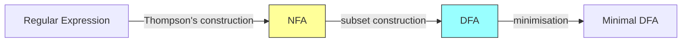
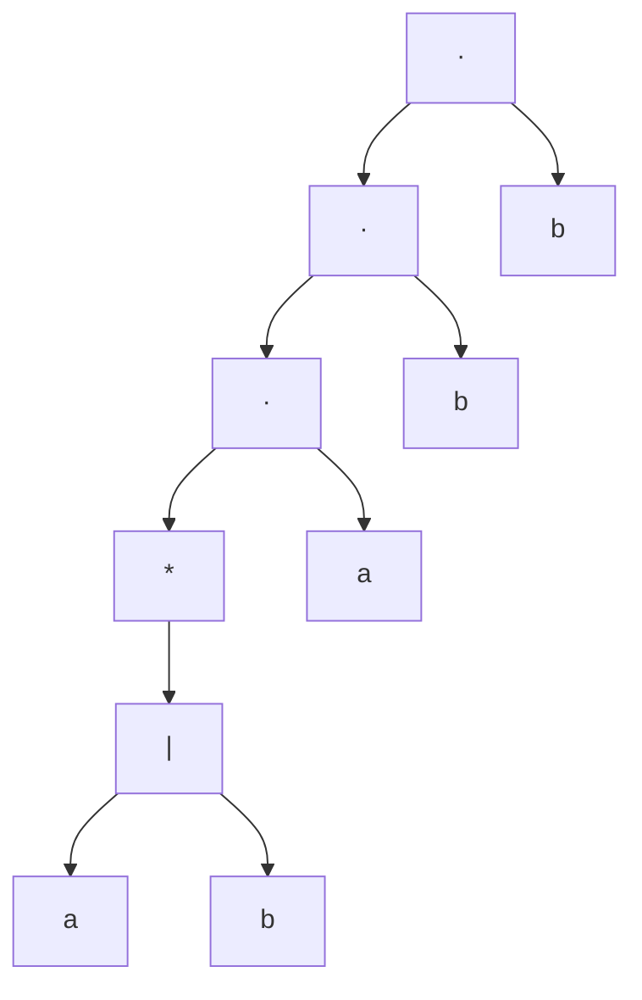

# Thompson's Construction & Subset Construction

> [!info] Lecture — 2026-10-19
> CS310 Programming Languages & Compiler — Week 4, Lectures 1 & 2
> Lecturer: Edgar Galván López · Source: `2026_CS310_Notes.pdf`

## The pipeline



## Thompson's construction (McNaughton–Yamada–Thompson)

Builds an NFA for any regular expression **bottom-up from its parse tree**. Every fragment has exactly **one start** and **one accepting** state (no incoming edge to the start, no outgoing edge from the accept), so fragments compose.

**Base case — a single symbol `a`:**

```
(start) ──a──▶ ((accept))
```

**Induction — union `r1 | r2`:**

```
        ε            r1           ε
   ┌─────────▶ [N(r1)] ──────────┐
   │                              ▼
(start)                       ((accept))
   │                              ▲
   └─────────▶ [N(r2)] ──────────┘
        ε            r2           ε
```

**Induction — concatenation `r1 r2`:**

```
(start) ──▶ [N(r1)] ──▶ [N(r2)] ──▶ ((accept))
```

**Induction — closure `r*`:**

```
              ε
   ┌────────────────────┐
   │                    ▼
(start) ──ε──▶ [N(r)] ──ε──▶ ((accept))
   ▲                    │
   └───────── ε ────────┘
```

The ε-loop lets the automaton take the body **zero or more** times.

## Parse tree for `r = (a|b)*abb`



Reading bottom-up: build NFAs for `a` and `b`, union them for `a|b`, close it for `(a|b)*`, then concatenate with `a`, `b`, `b`.

## Combining DFAs: union, intersection, complement

Given DFAs $L_1$ and $L_2$, the **product construction** builds a DFA whose states are pairs $(q_i, r_j)$:

| Operation | Accepting condition |
|---|---|
| **Union** $L_1 \cup L_2$ | pair where **either** $q_i$ **or** $r_j$ is accepting |
| **Intersection** $L_1 \cap L_2$ | pair where **both** are accepting |
| **Complement** $\overline{L}$ | swap accepting ↔ non-accepting states |

> [!example] Complement
> "An automaton that does **not** contain `a`", alphabet $\{a,b\}$ — take the DFA that *accepts* any string containing `a`, then flip its accepting and non-accepting states.

## Subset construction — NFA → DFA

Each DFA state is a **set** of NFA states. The algorithm:

1. The DFA **start state** = $\epsilon\text{-closure}(\text{NFA start state})$.
2. For each DFA state $S$ and each symbol $a$, the transition $S \xrightarrow{a} \epsilon\text{-closure}(\text{move}(S, a))$.
3. Repeat until no new DFA states appear.
4. DFA **accepting states** = any state whose set contains an NFA accepting state.

### Worked example (alphabet $\{0, 1\}$)

The slides convert an NFA (states $q_0 \ldots q_5$) with the resulting table:

| DFA state | on `0` | on `1` |
|---|---|---|
| $A = \{q_0, q_1, q_5\}$ (start) | $\Phi$ | $C = \{q_2, q_3\}$ |
| $C = \{q_2, q_3\}$ | $D = \{q_4, q_5, q_1\}$ | $\Phi$ |
| $D = \{q_4, q_5, q_1\}$ | $\Phi$ | $C = \{q_2, q_3\}$ |

> [!important] Two points the slides stress
> - **Name the new states** with single letters ($A$, $C$, $D$, …) rather than writing out the sets every time.
> - Watch what happens with **$\Phi$** (the empty set): a transition to $\Phi$ is a transition to a **dead/trap state** from which the input can never be accepted.

---

> [!tip] Next lecture
> Fill in the `next` field once the following notes arrive (the course continues with parsing, cf. the CS424 parsing notes).
