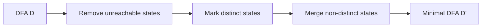

# DFA Minimisation

> [!info] Lecture — 2026-10-26
> CS310 Programming Languages & Compilers — Week 5, Lexical Analysis (DFA Minimisation)
> Lecturer: Edgar Galván López · Source: `week_5_DFA_min.pdf`, `week_5_NFA2DFA.pdf`

**Overview**

- A DFA may have more states than necessary; **minimisation** merges states that are "the same" behaviourally.
- The key idea is the **suffix language** of a state — two states are equivalent iff they share a suffix language.
- **Myhill–Nerode** theorem: a language is regular iff it has finitely many suffix languages, and the minimal DFA has exactly that many states.
- The **state-minimisation algorithm** (partition refinement) splits states into equivalence classes by their behaviour on inputs.

---

## 1. Suffix Languages

> [!note] Definition
> The **suffix language** of $L$ with respect to a word $x \in \Sigma^*$ is
> $$
> \llbracket L/x \rrbracket = \{ y \mid xy \in L \}
> $$
> — the set of words that, when appended to $x$ as a prefix, still give a word in $L$.

The **class of suffix languages** of $L$ is:
$$
C(L) = \{\, \llbracket L/x \rrbracket \mid x \in \Sigma^* \}
$$

> [!note] Suffix languages of a regular language
> For a DFA $M = (Q, \Sigma, \delta, q_0, F)$ accepting $L$, the suffix language $\llbracket L/x \rrbracket$ equals $L_q$ — the language accepted *starting from state $q$* — where $q$ is the state reached by $M$ on reading $x$. So the suffix languages of a regular language are exactly the languages $L_q$ for $q \in Q$.

---

## 2. Key Lemmas

- **Lemma 1** — For a regular language $L$, the number of distinct suffix languages is **bounded** (finite).
- **Lemma 2** — If $L$ has **infinitely many** distinct suffix languages, then $L$ is **not regular**.
  > [!example] Example
  > $a^n b^n,\ n \in \mathbb{N}$ has infinitely many suffix languages, so it can never be recognised by any FA.

- **Lemma 3** — $\varepsilon \in \llbracket L/x \rrbracket \iff x \in L$.
- **Lemma 4** — If $\llbracket L/x \rrbracket = \llbracket L/y \rrbracket$ then for all $a \in \Sigma$, $\llbracket L/xa \rrbracket = \llbracket L/ya \rrbracket$.

> [!important] Intuition
> Every state of a DFA is associated with a suffix language. If two states have the **same** suffix language, they can be **merged** into one.

---

## 3. Myhill–Nerode Theorem

> [!important] Myhill–Nerode
> A language $L \subseteq \Sigma^*$ is **regular iff** $C(L)$ is **finite**.
> More precisely: if $C(L)$ has exactly $k$ languages, we can build a DFA for $L$ with **only $k$ states** — and **any** DFA accepting $L$ must have at least $k$ states. All minimal DFAs for $L$ are **isomorphic** (unique up to state renaming).

---

## 4. Minimising a DFA

**Question:** can we construct a minimal DFA directly from a language?
**Answer:** not efficiently — computing suffix languages is hard. Instead we work from a **given DFA**:

1. **Remove** states unreachable from the start state.
2. **Mark** which of the remaining states are **distinct**.
3. **Merge** states that are not marked distinct.

> [!note] Distinct states
> $p$ and $q$ are **distinct** if there exists $w$ such that $\delta(p,w)$ is accepting and $\delta(q,w)$ is not (or vice versa).
> For $w = \varepsilon$: $p \in F,\ q \notin F$ (or vice versa) makes them distinct.

---

## 5. The State-Minimisation Algorithm

**Input:** DFA $D$ — **Output:** DFA $D'$ accepting the same language with as few states as possible.

1. Start with an initial **partition** $P = \{ F,\ S \setminus F \}$ (accepting vs non-accepting states).
2. Refine: for each group $G$ of $P$, split $G$ into subgroups such that two states $s,t$ stay together **iff** for every input symbol $a$, their $a$-transitions go to states in the **same group** of $P$.
3. If the new partition equals the old one, stop (call it $P_{final}$); otherwise repeat step 2.
4. Pick one **representative** per group of $P_{final}$:
   - (a) start state = representative of the group containing the original start state;
   - (b) accepting states = representatives of groups containing accepting states;
   - (c) transitions: if $s$ (rep of group $G$) goes to $t$ on input $a$, and $r$ is the rep of $t$'s group $H$, then $s \xrightarrow{a} r$ in $D'$.

> [!tip] Note
> Each final group contains either **only accepting** or **only non-accepting** states (guaranteed by the initial split).

---

## 6. NFA → DFA Complexity (recap)

From `week_5_NFA2DFA.pdf`:

- ε-closure computation is $O(n^2)$ per state; over $n$ states $O(n^3)$.
- The subset construction itself produces up to $2^n$ states.
- **Total conversion time:** $O(n^3 2^n)$.

---

## 7. Summary

| Concept | Meaning |
|---|---|
| Suffix language $\llbracket L/x \rrbracket$ | $\{y \mid xy \in L\}$ |
| $C(L)$ | set of all suffix languages |
| Myhill–Nerode | $L$ regular $\iff C(L)$ finite; minimal DFA has $\|C(L)\|$ states |
| Distinct states | some $w$ separates them (one accepting, one not) |
| Partition refinement | repeatedly split groups until stable |

> [!tip] Next lecture
> We leave the lexical (token) side and move to **[[2026-11-02 - Syntax Analysis & Grammar]]** — the parser.
