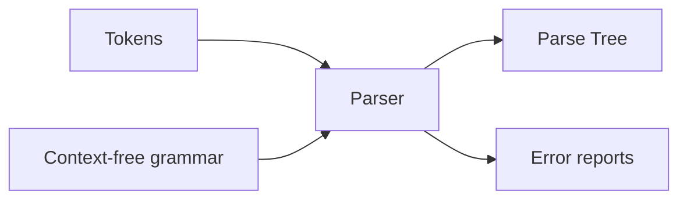

# Syntax Analysis: Grammar

> [!info] Lecture — 2026-11-02
> CS310 Programming Languages & Compilers — Week 6, Syntax Analysis (Grammar)
> Lecturer: Edgar Galván López · Source: `week_6_l1.pdf`

**Overview**

- The **parser** turns a stream of tokens into a **parse tree**, reporting syntax errors with position.
- Parsers come in three families: **universal**, **top-down** (LL), and **bottom-up** (LR).
- A language's syntax is described by a **context-free grammar (CFG)** — a 4-tuple $(V, \Sigma, R, S)$.
- **Derivations** expand a grammar into a sentence; a grammar is **ambiguous** if a sentence has more than one parse tree.

---

## 1. The Role of the Parser

Every programming language has rules for the syntactic structure of well-formed programs: a program is made of blocks → statements → expressions → tokens.

- The parser is responsible for **reporting syntax errors** (correct line/column).
- For well-formed programs it **constructs a parse tree** and passes it to the rest of the compiler.

---

## 2. Types of Parsers

| Type | Description | Example |
|---|---|---|
| Universal | Can parse any grammar (inefficient for production compilers) | CYK, Earley |
| Top-down | Builds tree root→leaves, leftmost derivation | LL |
| Bottom-up | Builds tree leaves→root, rightmost derivation | LR |

- **LL** = left-to-right scan, **leftmost** derivation.
- **LR** = left-to-right scan, **rightmost** derivation.

---

## 3. Error Handling

> [!note] Error levels
> 1. **Lexical** — misspelled identifier/keyword/operator.
> 2. **Syntactic** — unbalanced parentheses.
> 3. **Semantic** — operator applied to an incompatible operand.
> 4. **Logical** — infinitely recursive call.

**Goals of the error handler:**
1. Report errors clearly and accurately.
2. Recover quickly enough to detect subsequent errors.
3. Add minimal overhead to correct programs.

---

## 4. Error-Recovery Strategies

| Strategy | Idea | Risk |
|---|---|---|
| Panic-mode | Skip to a synchronising token (e.g. `}`) | Guaranteed **not** to loop forever |
| Phrase-level | Local correction | **May** loop forever |
| Error productions | Augment the grammar to anticipate common errors | — |
| Global correction | Minimal least-cost sequence of changes | Expensive |

> [!note] Real-world figures
> ~60% of errors are **punctuation** errors (comma for semicolon, missing semicolon), ~20% operator/operand, ~15% keyword.

---

## 5. Context-Free Grammar (Formal Definition)

> [!important] Definition
> A **context-free grammar** is a 4-tuple $(V, \Sigma, R, S)$ where:
> - $V$ — finite set of **nonterminals** (variables),
> - $\Sigma$ — finite set of **terminals**, disjoint from $V$,
> - $R$ — finite set of **rules/productions** (each a list of terminals & variables),
> - $S \in V$ — the **start** variable.

Example: `stmt → if expr then stmt else stmt`.

---

## 6. Notational Conventions

**Terminals:** `a, b, c` (lowercase early alphabet); operator symbols `+`, `-`; punctuation `(`, `,`; digits `0…9`; **boldface** strings like **id**, **if**.

**Nonterminals:** `A, B, C` (uppercase early); `S` usually the start symbol; lowercase *italic* names like *expr*, *stmt*.

**Other:** $X, Y, Z$ = grammar symbols (terminal or nonterminal); $u,v,\dots,z$ = strings of terminals; Greek $\alpha, \beta, \gamma$ = strings of grammar symbols. A production $A \to \alpha$ has **head** $A$ and **body** $\alpha$. Multiple $A$-productions collapse to $A \to \alpha_1 \mid \alpha_2 \mid \dots \mid \alpha_n$. Unless stated otherwise, the **left side of the first production is the start symbol**.

---

## 7. Derivations

Given $E \to E + E \mid E * E \mid (E) \mid -E \mid id$, replacing a single $E$ by $-E$ is written $E \Rightarrow -E$ ("$E$ derives $-E$").

> [!example] Deriving $-(id)$
> $$
> E \Rightarrow -E \Rightarrow -(E) \Rightarrow -(id)
> $$

General rule: if $A \to \gamma$ is a production, then $\alpha A \beta \Rightarrow \alpha \gamma \beta$.

Notation:
- $\Rightarrow$ — derives in **one** step.
- $\Rightarrow^*$ — derives in **zero or more** steps.
- $\Rightarrow^+$ — derives in **one or more** steps.

**Leftmost** derivation: always expand the leftmost nonterminal. **Rightmost**: always expand the rightmost.

---

## 8. Ambiguity

> [!important] Definition
> A grammar is **ambiguous** if some sentence has **more than one parse tree** — equivalently, more than one leftmost (or rightmost) derivation.

> [!example] $id + id * id$
> $$
> \begin{aligned}
> E &\Rightarrow E + E \Rightarrow id + E \Rightarrow id + E*E \Rightarrow id + id*E \Rightarrow id + id*id \\
> E &\Rightarrow E * E \Rightarrow E + E*E \Rightarrow id + E*E \Rightarrow id + id*E \Rightarrow id + id*id
> \end{aligned}
> $$
> Two parse trees → the grammar is ambiguous.

---

## 9. Summary

| Term | Meaning |
|---|---|
| Parser | Builds parse tree, reports errors |
| LL / LR | Top-down (leftmost) / bottom-up (rightmost) |
| CFG | $(V, \Sigma, R, S)$ |
| Derivation | $\Rightarrow, \Rightarrow^*, \Rightarrow^+$ |
| Ambiguous grammar | Sentence with >1 parse tree |

> [!tip] Next lecture
> Ambiguity (the dangling-else) and how to **eliminate left recursion and left factor** — **[[2026-11-09 - Left Recursion & Left Factoring]]**.
