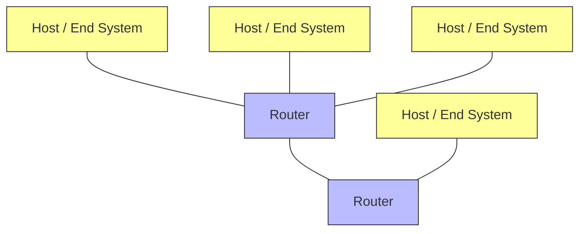
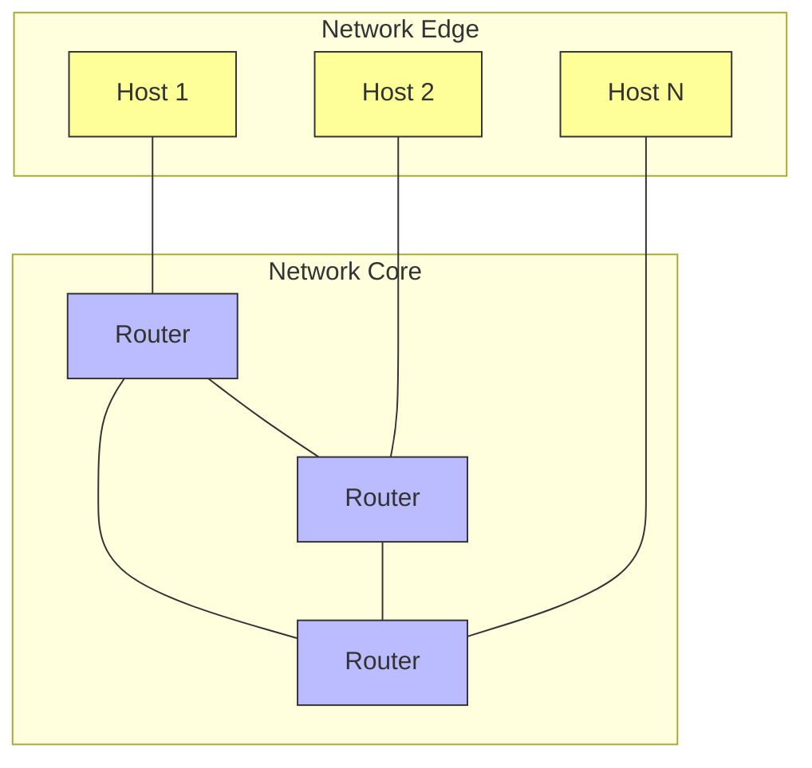

# Introduction & Physical Layer

> [!info] Lecture 1 — 2026-09-21
> CS320 Computer Networks

## Core Definitions

- **Host = End System** — any device connected to the network
- **Communication Links** — physical media connecting end systems
- **"Internet"** = networks of networks



## Protocols

A protocol defines **format**, **order**, and **receipt** of messages between entities.

| Protocol | Layer |
|---|---|
| TCP | Transport |
| IP | Network |
| HTTP | Application |
| 802.11 | Link (Wi-Fi) |

### Internet Standards

- **RFC** — Request for Comments
- **IETF** — Internet Engineering Task Force

## Application Programming Interface

```
Internet → TCP → Socket
```

The **socket** is the API between application and transport layers.

## Network Structure



### Network Edge

- End systems (hosts)
- Access network
- Physical media

### Network Core

- Interconnected routers
- Packet switching

## Edge Access (局域网)

1. **Residential access** — home connections
2. **Institutional access** — university/enterprise networks
3. **Mobile networks** — cellular wireless

## Access Technologies

### DSL (Digital Subscriber Line)

```
┌──────┐      ┌─────┐      ┌─────┐
│  PC  │ ───▶ │ DSL │ ───▶ │ ISP │
└──────┘      └─────┘      └─────┘
              modem
```

- Access rate: up to **Gbps**
- Uses existing telephone lines

### Cable Network

```
Signal ──▶ [Frequency Division Multiplexing] ──▶ Multiple channels
```

- **FDM** — frequency division multiplexing
- Voltage / signal modulation

### Ethernet

- Wired LAN technology

### Wireless

```
┌──────────────┐     ┌─────────────────────┐
│ Wireless LAN │     │ Wide-Area Wireless  │
│   (Wi-Fi)    │     │  3G / 4G / 5G / 6G  │
└──────────────┘     └─────────────────────┘
```

## Packet Transmission Delay

```
L (bits)       → packet length
R (bits/sec)   → transmission rate
```

$$d_{trans} = \frac{L}{R}$$

- **L** — packet length in bits
- **R** — transmission rate (link bandwidth) in bits/sec

---

> [!tip] Next lecture
> Fill in the `next` field in frontmatter once the next notes arrive.
