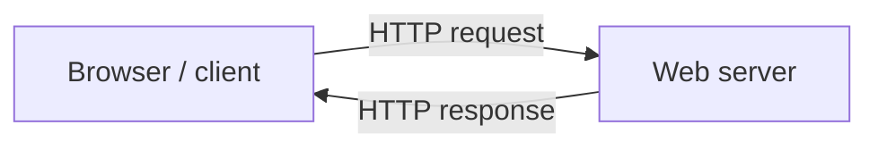
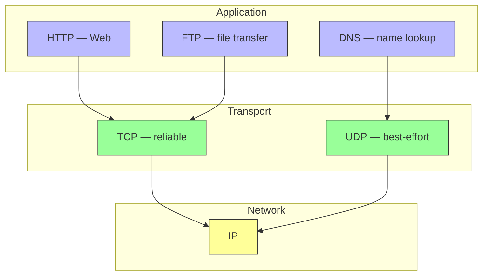

# The Web & HTTP

> [!info] Lab 2 Reading — 2026-10-08
> CS320 Computer Networks · Kurose & Ross, *Computer Networking: A Top-Down Approach* (6e), §2.2–2.3

## HTTP Basics

**HyperText Transfer Protocol (HTTP)** — the Web's application-layer protocol (RFC 1945, RFC 2616). Implemented as a **client program** and a **server program** exchanging HTTP messages.

- **Web page = objects** — a base HTML file + referenced objects (images, JS, video), each addressable by a single **URL**
- **URL** = hostname + path, e.g. `http://www.someSchool.edu/someDepartment/picture.gif`
  - hostname: `www.someSchool.edu`
  - path: `/someDepartment/picture.gif`
- Browser = client side, Web server (Apache, IIS) = server side



| Property | Value |
|---|---|
| Transport protocol | **TCP** (client initiates connection, port 80) |
| State | **stateless** — server keeps no info about clients |
| Architecture | client-server (server always on, fixed IP) |

> [!note] Why stateless?
> If a client fetches the same object twice, the server just resends it — it has "completely forgotten" the first time. This simplifies server design; state is later bolted on with **cookies**.

## Non-Persistent vs Persistent Connections

**Non-persistent** — each request/response pair gets its own TCP connection, closed after one object.
**Persistent** — connection stays open for subsequent requests (HTTP default, with pipelining).

### Non-Persistent: step by step

Example: base HTML + 10 JPEGs = **11 objects**, all on one server.

1. Client opens TCP connection to server **port 80**
2. Client sends request (path `/someDepartment/home.index`) via socket
3. Server retrieves object, wraps it in a response, sends it back
4. Server tells TCP to close the connection
5. Client receives response, parses HTML, finds the 10 image references
6. Repeat 1–4 **for each referenced object** → **11 TCP connections total**

- Browsers typically open **5–10 parallel connections** (configurable; set to 1 = fully serial)

### RTT Calculation

**RTT (Round-Trip Time)** = time for a small packet to go client → server → client (propagation + queuing + processing delays).

```
Initiate TCP        ──── 1 RTT (first two handshake steps)
    │
Request file        ──── 1 RTT (third handshake step + request/response)
    │
Entire file received
```

> [!important] Key formula
> Total response time ≈ **2 RTTs + transmission time** of the HTML file
> (1 RTT to set up TCP + 1 RTT to request and receive the object)

Each object on a non-persistent connection suffers this **2 RTT delay** + TCP buffer/variable overhead per connection — the motivation for persistence.

### Persistent Connections

- Server leaves the connection open after a response
- Entire page (HTML + 10 images) over **one** TCP connection
- **Pipelining**: send requests back-to-back without waiting for replies; server sends objects back-to-back
- Server closes idle connections after a configurable timeout
- HTTP default mode: **persistent with pipelining**

## HTTP Message Format

Both messages are plain **ASCII text**, lines end with `cr lf`.

### Request Message

```
GET /somedir/page.html HTTP/1.1
Host: www.someschool.edu
Connection: close
User-agent: Mozilla/5.0
Accept-language: fr
```

```
Request line   method  sp  URL  sp  Version  cr lf
Header lines   header field name: sp value  cr lf
               ...
Blank line     cr lf
Entity body
```

| Field | Example | Meaning |
|---|---|---|
| Method | `GET` | what to do (GET, POST, HEAD, PUT, DELETE) |
| URL | `/somedir/page.html` | which object |
| Version | `HTTP/1.1` | protocol version |

Header lines in the example:

- `Host:` — required by **proxy caches** (needed even though TCP already knows the host)
- `Connection: close` — browser does **not** want persistent connections
- `User-agent:` — browser type; server can send different versions per agent
- `Accept-language:` — content negotiation (prefers French version)

| Method          | Purpose                                                                 |
| --------------- | ----------------------------------------------------------------------- |
| **GET**         | fetch object (most common); entity body empty                           |
| **POST**        | submit form data — form fields go in entity body                        |
| **GET + query** | forms can also use GET: `www.somesite.com/animalsearch?monkeys&bananas` |
| **HEAD**        | like GET but server omits object (debugging)                            |
| **PUT**         | upload object to a path (web publishing)                                |
| **DELETE**      | remove object on the server                                             |

### Response Message

```
HTTP/1.1 200 OK
Connection: close
Date: Tue, 09 Aug 2011 15:44:04 GMT
Server: Apache/2.2.3 (CentOS)
Last-Modified: Tue, 09 Aug 2011 15:11:03 GMT
Content-Length: 6821
Content-Type: text/html

(data data data data data ...)
```

```
Status line   version  sp  status code  sp  phrase  cr lf
Header lines  header field name: sp value  cr lf
Blank line    cr lf
Entity body   ← the requested object itself
```

| Header | Meaning |
|---|---|
| `Connection: close` | server will close TCP after this message |
| `Date:` | when the response was **created/sent** (not when object was made) |
| `Server:` | software that generated the response (like User-agent for servers) |
| `Last-Modified:` | when the object was last modified — **critical for caching** |
| `Content-Length:` | object size in bytes |
| `Content-Type:` | object type (officially, not the file extension) |

**Common status codes:**

| Code | Phrase | Meaning |
|---|---|---|
| 200 | OK | success, object returned |
| 301 | Moved Permanently | moved — new URL in `Location:` header, client auto-retrieves |
| 400 | Bad Request | server couldn't understand the request |
| 404 | Not Found | document doesn't exist |
| 505 | HTTP Version Not Supported | requested protocol version not supported |

> [!tip] Try it yourself
> `telnet cis.poly.edu 80` then type `GET /~ross/ HTTP/1.1`, `Host: cis.poly.edu`, press Enter twice. Swap `GET` → `HEAD` to see only the message lines, or `/~ross/` → `/~banana/` to see a 404.

## The GET Method

**GET** asks the server to return the object identified in the URL — the workhorse of HTTP ("the great majority of HTTP request messages use GET").

```
Browser ──GET /somedir/page.html──▶ Server
Browser ◀──200 OK + object──────── Server
```

**Anatomy of a GET request line:**

```
GET /somedir/page.html HTTP/1.1
↑     ↑                   ↑
method URL                 version
```

- **Entity body is empty** — everything the server needs is in the URL
- **Safe**: GET must not change server state (retrieval only)
- **Idempotent**: doing it 1 or 10 times has the same effect (so it's safe to retry after a timeout)

**GET with a query string** — HTML forms often use GET and put the input in the URL instead of the body:

```
www.somesite.com/animalsearch?monkeys&bananas
```

(the `?` starts the query; fields are separated by `&` — this is why you see long URLs while browsing)

### GET vs POST

| | GET | POST |
|---|---|---|
| Data location | URL (query string) | entity body |
| Body | empty | form fields |
| Bookmarks / shareable URL | yes | no |
| Server state change | must not change | may change (submit form, upload) |
| Typical use | fetch page / search | login, checkout, file upload |

> [!note] Conditional GET
> GET also powers cache validation — a GET with an extra `If-Modified-Since:` header becomes a **conditional GET** (covered below).

## Cookies — User-Server Interaction

HTTP is stateless, but sites often need to **identify users** (access control, shopping carts, personalisation). Cookies (RFC 6265) have four components:

1. `Set-cookie:` header in the HTTP **response**
2. `Cookie:` header in subsequent HTTP **requests**
3. A **cookie file** on the user's end system (managed by the browser)
4. A **back-end database** at the website

### Example flow

```
Susan's browser ──▶ Amazon server
Amazon creates ID 1678, stores entry in back-end DB
Amazon ──response──▶ Set-cookie: 1678
Browser appends "amazon: 1678" to cookie file

One week later:
Every request ──▶ Cookie: 1678  ──▶ Amazon recognises the user
```

- Cookie file also still holds `ebay: 8734` from an earlier visit — cookies are **per-site**
- Cookies create a **session layer on top of stateless HTTP** (e.g. webmail login)
- With registration info, Amazon links name/credit card to ID 1678 → **one-click shopping**
- Privacy concern: sites can build detailed profiles and sell them to third parties

## Web Caching (Proxy Server)

A **Web cache / proxy server** has its own disk storage and satisfies HTTP requests **on behalf of** the origin server.

```
1. Browser ──TCP──▶ Web cache: HTTP request
2. Cache has copy? ──yes──▶ respond directly (fast)
                          └─no──▶ connect to origin server, fetch,
                                  store copy locally, forward to client
```

> [!note] A cache is both client and server
> To the browser it acts as a **server**; to the origin server it acts as a **client**.

**Why deploy caches:**
1. **Reduce response time** — especially if cache-to-client link is much faster than client-to-origin bottleneck
2. **Reduce traffic** on the institution's access link (and Internet-wide traffic) → delay upgrading bandwidth

### Worked Example — the 15 Mbps bottleneck

```
Internet ──[15 Mbps access link]── Institution ──[100 Mbps LAN]── browsers
```

- Avg object size **1 Mbit**, request rate **15 requests/sec**, Internet delay **2 sec**
- Traffic intensity = (15 req/s × 1 Mbit) / 15 Mbps = **1.0** → delay grows without bound (minutes!)
- On the LAN: 15 × 1 / 100 Mbps = **0.15** → negligible

**Option A** — upgrade link to 100 Mbps: intensity → 0.15, total ≈ 2 s, but **costly**

**Option B** — add a Web cache (hit rate **0.4**, typical range 0.2–0.7):

- 40% of requests served from cache in ~0.01 s
- 60% go through: intensity drops 1.0 → **0.6** (below 0.8 = small delay)
- Average delay = 0.4 × 0.01 + 0.6 × 2.01 ≈ **1.2 seconds** — better than A, no link upgrade

Caches are cheap (public-domain software on inexpensive PCs). **CDNs** (Akamai, Limelight; dedicated: Google, Microsoft) are geographically distributed caches that localise traffic.

## Conditional GET — Keeping Caches Fresh

Problem: a cached copy may be **stale** (object modified at origin after caching).

A request is a **conditional GET** if it (1) uses the `GET` method and (2) includes an `If-Modified-Since:` header.

### The two-message dance

**Step 1 — original fetch** (cache stores the object *and* its `Last-Modified` date):

```
Cache → server:   GET /fruit/kiwi.gif HTTP/1.1
                  Host: www.exotiquecuisine.com

Server → cache:   HTTP/1.1 200 OK
                  Last-Modified: Wed, 7 Sep 2011 09:23:24
                  Content-Type: image/gif

                  (data data data data data ...)
```

**Step 2 — one week later, another browser asks for the same object:**

```
Cache → server:   GET /fruit/kiwi.gif HTTP/1.1
                  Host: www.exotiquecuisine.com
                  If-modified-since: Wed, 7 Sep 2011 09:23:24
```

The value of `If-modified-since:` is **exactly** the `Last-Modified:` value from the original response.

**Step 3a — object unchanged (most common):**

```
Server → cache:   HTTP/1.1 304 Not Modified
                  Date: Sat, 15 Oct 2011 15:39:29
                  Server: Apache/1.3.0 (Unix)

                  (empty entity body)
```

**Step 3b — object changed at the origin:**

```
Server → cache:   HTTP/1.1 200 OK
                  Last-Modified: <new date>
                  Content-Type: image/gif

                  (fresh data ...)
```

### Why it matters

- **304** → cache serves its local copy immediately — no object re-sent, **bandwidth saved**, low user-perceived delay
- **200** → cache replaces its stale copy with the fresh one
- Conditions for a conditional GET request: (1) method = GET, (2) header `If-Modified-Since:` present
- Depends on the `Last-Modified:` header from the original response — that's why it's "critical for object caching"

## TCP vs UDP — Transport Under HTTP

HTTP itself doesn't move bits — it hands messages to a **transport-layer protocol**. The two candidates:

| Feature | TCP | UDP |
|---|---|---|
| Connection | connection-oriented (handshake first) | connectionless |
| Reliability | **reliable** — delivery, ordering, retransmission guaranteed | best-effort — packets may be lost, reordered, duplicated |
| Flow / congestion control | yes | no |
| Overhead | heavier (headers, ACKs, state) | lightweight, small headers |
| Data unit | byte stream | datagrams |
| Setup cost | 1 RTT (three-way handshake) | none — send immediately |
| Used by | **HTTP, FTP, SMTP, HTTPS** | **DNS, VoIP, video streaming, online games** |

> [!important] Why HTTP chooses TCP
> HTTP needs the *whole* page, *in order*. TCP provides exactly that — each HTTP request/response **eventually arrives intact**, and HTTP never worries about loss or reordering. That's the payoff of the layered architecture: **TCP handles reliability, HTTP handles meaning**.

```
HTTP message  ──▶  TCP (reliable delivery)  ──▶  IP  ──▶  link  ──▶  physical
                  (segment, ACK, retransmit)
```

- HTTP client initiates a **TCP connection** (port 80), gets a socket, sends messages into it
- TCP buffers + variables exist per connection — a cost paid for every non-persistent connection
- UDP is chosen when **speed beats correctness**: a lost voice sample is better played late than retransmitted

### Where the 3-way handshake fits

```
Client                              Server
  │ ─── SYN ──────────────────────▶ │  ┐
  │ ◀── SYN-ACK ─────────────────── │  ├─ 1 RTT
  │ ─── ACK + HTTP request ───────▶ │  ┘
  │ ◀── HTTP response ───────────── │  ─ 1 RTT
```

This is the "first two parts take one RTT" from the response-time calculation above.

## Protocols Across the Two Notes

Everything from Lecture 1 and this reading, in one stack:

| Layer | Protocols | From which note |
|---|---|---|
| **Application** | HTTP (port 80), FTP | [[2026-10-08 - The Web & HTTP\|this note]] |
| **Transport** | TCP (reliable) · UDP (best-effort) | both (Lecture 1 defined them; HTTP uses TCP) |
| **Network** | IP | [[2026-09-21 - Introduction & Physical Layer\|Lecture 1]] |
| **Link** | 802.11 (Wi-Fi), Ethernet, DSL, cable | [[2026-09-21 - Introduction & Physical Layer\|Lecture 1]] |
| **Physical** | media (fibre, copper, radio) | [[2026-09-21 - Introduction & Physical Layer\|Lecture 1]] |



## FTP (§2.3 — start)

File transfer protocol: user on a **local host** transfers files to/from a **remote host**.

1. User gives hostname → FTP client opens **TCP connection** to FTP server
2. User provides ID + password (sent as FTP **commands** over TCP)
3. After authorisation, copy files local ↔ remote

```
User → [FTP user interface] → [FTP client] → TCP → [FTP server] → remote file system
```

---

## Summary

```
HTTP (application layer, TCP, port 80, stateless)
 │
 ├─ Connections
 │    ├─ non-persistent: 1 object/connection → 2 RTT + transmission each
 │    └─ persistent (default): one connection + pipelining
 │
 ├─ Messages (ASCII)
 │    ├─ request:  method URL version | headers | body
 │    │    GET · POST · HEAD · PUT · DELETE
 │    └─ response: version code phrase | headers | body
 │         200 OK · 301 · 400 · 404 · 505
 │
 ├─ Cookies          → session layer over stateless HTTP (4 components)
 ├─ Web caching       → proxy: less delay + less access-link traffic
 │     example: intensity 1.0 → 0.6, delay 2s+ → ~1.2s
 ├─ Conditional GET   → If-Modified-Since / 304 Not Modified
 └─ FTP               → TCP, login (user/pass), copy files
```

---

## Related

- [[2026-09-21 - Introduction & Physical Layer]]

---

> [!tip] Next lecture
> Fill in the `next` field in frontmatter once the next notes arrive.
