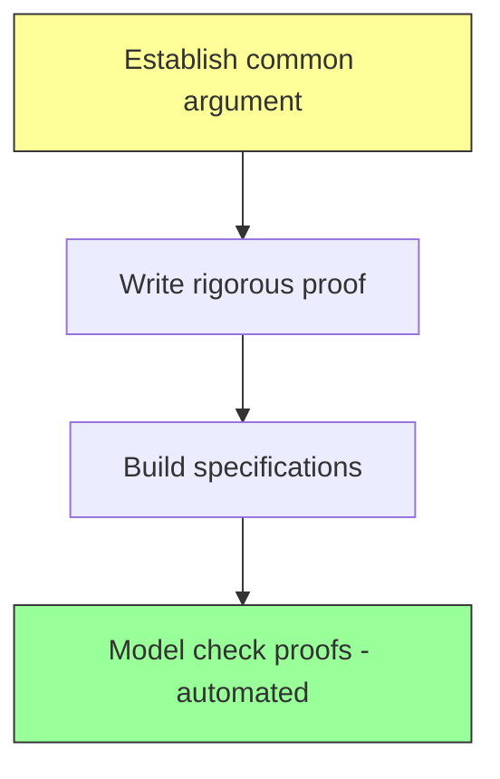
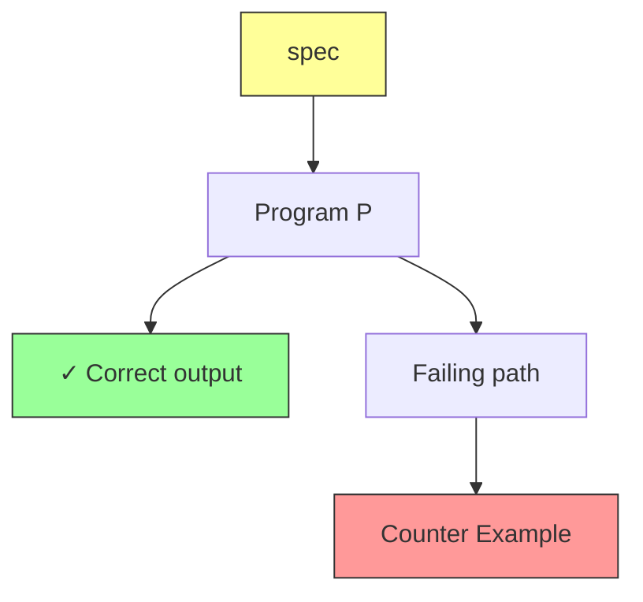

# Software Verification — Foundations

> [!info] Lecture 1 — 2026-09-21
> CS357 Software Verification

## Course Structure

| Weeks | Lecturer |
|---|---|
| 1–5 | Wu |
| 6 | Study week |
| 7–12 | Wu / Abhishek |

- **Assessment**: 20% CA – 80% Exam
- **Lecturer**: Thomas Flinkow (tflinkow@unimail.ie)
- ⚠️ Contact while **Lab collision** 

## Module Theme

- **POP** — Principles of Programming

## Research Topics

- **FRET** → NASA (formal specification tool)
- Specification
- Verification tool development
- Robotic → Hardware verification

## Confidence Level

```
Confidence
    ▲
    │        ████
    │      ████████
    │    ████████████
    │  ████████████████
    └──────────────────▶ Rigour
    0                 100
```

Higher confidence = more rigorous proof required.

## Traditional Verification Flow



## Verification Approaches

### Design by Contract / Interactive Proving / Graph-based verification

### Inductive Proving & Model Checking

| Tool | Type |
|---|---|
| **NuSMV** | Model checker |
| **SPIN** | Model checker |
| **TLA+** | Specification / model checking |

### Interactive Verification

| Tool | Description |
|---|---|
| **LEAN** | Proof assistant / prover |
| **Isabelle** | Theorem prover |

### Automated Verification

| Tool | Description |
|---|---|
| **Daikon** | Invariant detector |
| **TLA+** | Temporal logic specification |
| **Event-B** | Formal method for system design |

## Key Concepts

- **Loop invariants** — condition true before and after each loop iteration
- **Precondition** — must hold before function executes
- **Postcondition** — must hold after function executes

## Key Diagram — Program Verification



```
              spec
                │
                ▼
           ┌─────────┐
           │    P    │
           └────┬────┘
          ╱     │     ╲
         ╱      │      ╲
        ▼       ▼       ▼
       (✓)     (✓)     (N) ──▶ Counter Example
```

- A failing execution path produces a **counter example**
- Counter examples help debug specifications and programs

---

> [!tip] Next lecture
> Fill in the `next` field in frontmatter once the next notes arrive.
