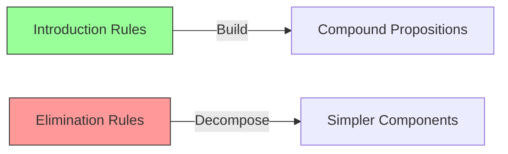

# Software Verification — Natural Deduction

> [!info] Lecture — 2026-09-28
> CS357 Software Verification

## What is Natural Deduction?

Natural deduction is a formal system for reasoning about logical propositions. It lets us derive conclusions from assumptions using a set of **rules**. Each rule tells us how to introduce or eliminate a logical connective (∧, ∨, →, ¬, etc.).

The key idea: we reason **from assumptions**, tracking what we assume and what we can conclude.

## Two Types of Rules

| Rule Type | Purpose |
|---|---|
| **Introduction rules** | Build up compound propositions (form the goal) |
| **Elimination rules** | Break down compound propositions (break up hypothesis) |

Think of it like building with LEGO:
- **Introduction** = snapping pieces together to build something
- **Elimination** = taking something apart to see its components

## Inference Trees

Inference trees (also called **proof trees**) visualise logical reasoning. They look like upside-down trees — conclusions at the bottom, premises at the top.

### Example One — Simple Inference

```
  A    B
───────
   X
```

From premises A and B, we derive X. The horizontal line separates what we **have** (above) from what we **conclude** (below).

### Example Two — Sub-proof with Assumption

```
  [A]¹
  ⋮
  C
──────── X
```

Here we **assume** A (marked with brackets and a label `1`), derive C through some steps, and then conclude X. The bracket `[A]` indicates a temporary assumption that can be **discharged** (closed off) once we've used it.

## Implication Rules (→)

The most fundamental rules in natural deduction deal with implication (→), also written as ⇒.

### Implication Introduction (→I)

```
  [A]¹
   ⋮
   B
───────
A → B      ¹
```

**Rule**: If assuming A lets you derive B, then you can conclude A → B.

The `¹` means we **discharge** assumption A — it was temporary and is no longer an active premise.

**Example**: To prove "if it rains, then the ground is wet":
1. Assume "it rains" (temporary)
2. From that, derive "the ground is wet"
3. Discharge the assumption → conclude "if it rains, then the ground is wet"

### Implication Elimination (→E) — Modus Ponens

```
  A    A → B
─────────────
      B
```

**Rule**: If you have A, and you have A → B, then you can conclude B.

This is the most intuitive rule: "A is true, and A implies B, so B must be true."

**Inference example**:

| # | Statement | Justification |
|---|---|---|
| 1 | A | Premise |
| 2 | A → B | Premise |
| 3 | B → C | Premise |
| 4 | B | → Elim 1, 2 |
| 5 | C | → Elim 3, 4 |

We chain modus ponens: A gives us B (using A → B), then B gives us C (using B → C).

## Q.E.D.

> [!note] Q.E.D.
> **Quod Erat Demonstrandum** — Latin for "which was to be demonstrated."
> 
> Written at the end of a proof to signal that the proof is complete and the goal has been reached.

## Worked Example — Lemma 6

> [!example] Lemma 6
> Prove: A → (A → B) → (B → C) → C

**Strategy**: We need to introduce three implications (→I three times), then chain them together.

**Proof sketch**:

```
  A       A → B       B → C
─────────────────────────────────
              C
```

| Step | Action | Goal state |
|---|---|---|
| 1 | intro (assume A) | A ⊢ ? |
| 2 | intro (assume A → B) | A, A → B ⊢ ? |
| 3 | intro (assume B → C) | A, A → B, B → C ⊢ ? |
| 4 | apply H1 (→E on A and A → B) | ⊢ B |
| 5 | apply H2 (→E on B and B → C) | ⊢ C |
| 6 | exact H | C derived ✓ |
| 7 | qed | A → (A → B) → (B → C) → C ✓ |

The pattern: **introduce** all assumptions, then **eliminate** them to reach the goal.

## From Paper to Coq — Gallina & Tactics

Coq is a proof assistant that implements natural deduction. You write proofs as programs in **Gallina** (the specification language) using **tactics** (commands that manipulate the proof state).

### Core Tactics ↔ Natural Deduction Rules

| Natural Deduction | Coq Tactic | What it does |
|---|---|---|
| →I (Implication Intro) | `intro` | Assume the LHS of an implication |
| →E (Implication Elim) | `apply` / `exact` | Use an implication on a hypothesis |
| ∧I (Conjunction Intro) | `split` | Prove both halves of an AND |
| ∧E (Conjunction Elim) | `destruct` | Unpack an AND into its parts |
| ∨I (Disjunction Intro) | `left` / `right` | Choose one side of an OR |
| ∨E (Disjunction Elim) | `destruct` with cases | Case-split on an OR |
| ¬I (Negation Intro) | `intro` | Assume the positive, derive False |
| ¬E (Negation Elim) | `contradiction` / `absurd` | Derive False from P and ¬P |
| ⊥E (False Elim) | `contradiction` | From False, anything follows |

### Lemma 6 in Coq

The same proof from the handwritten notes, translated to Coq:

```coq
(* Lemma 6: A → (A → B) → (B → C) → C *)

Lemma lemma6 : forall (A B C : Prop),
  A -> (A -> B) -> (B -> C) -> C.
Proof.
  intros A B C.        (* introduce all propositions *)
  intros HA HAB HBC.   (* introduce hypotheses: A, A→B, B→C *)
  apply HBC.           (* goal becomes: prove B *)
  apply HAB.           (* goal becomes: prove A *)
  exact HA.            (* we have A — done *)
Qed.
```

**Step-by-step breakdown**:

| Coq Tactic | Natural Deduction Equivalent | Proof State |
|---|---|---|
| `intros A B C` | Declare parameters | A B C : Prop ⊢ A → (A→B) → (B→C) → C |
| `intros HA HAB HBC` | →I three times | HA : A, HAB : A→B, HBC : B→C ⊢ C |
| `apply HBC` | →E (use B→C) | ... ⊢ B |
| `apply HAB` | →E (use A→B) | ... ⊢ A |
| `exact HA` | We have A | ✓ Q.E.D. |

## More Coq Examples

### Example 1 — Conjunction (AND)

```coq
(* If A and B are true, then B and A are true *)
Lemma and_comm : forall (A B : Prop),
  A /\ B -> B /\ A.
Proof.
  intros A B H.       (* H : A /\ B *)
  destruct H as [HA HB].  (* split H into HA : A and HB : B *)
  split.              (* prove both sides of B /\ A *)
  - exact HB.         (* left side: B *)
  - exact HA.         (* right side: A *)
Qed.
```

**What happens**:
- `destruct H` unpacks `A /\ B` into two separate facts
- `split` says "I'll prove both parts"
- Each bullet `-` handles one part

### Example 2 — Disjunction (OR)

```coq
(* If A is true, then A or B is true *)
Lemma or_intro_l : forall (A B : Prop),
  A -> A \/ B.
Proof.
  intros A B HA.
  left.               (* choose the left side of A \/ B *)
  exact HA.
Qed.

(* If B is true, then A or B is true *)
Lemma or_intro_r : forall (A B : Prop),
  B -> A \/ B.
Proof.
  intros A B HB.
  right.              (* choose the right side of A \/ B *)
  exact HB.
Qed.
```

**What happens**:
- `left` / `right` picks which side of the OR you're proving
- No need to know the other side at all

### Example 3 — Negation & False

```coq
(* Negation is just implication to False: ¬A means A → False *)
Lemma negation_example : forall (A : Prop),
  A -> ~A -> False.
Proof.
  intros A HA HNA.    (* HA : A, HNA : ¬A (i.e., A → False) *)
  apply HNA.          (* goal becomes: prove A *)
  exact HA.           (* we have A — contradiction! *)
Qed.

(* From False, anything follows (ex falso quodlibet) *)
Lemma ex_falso : forall (A : Prop),
  False -> A.
Proof.
  intros A HF.
  contradiction.      (* HF is False — we're done, anything follows *)
Qed.
```

### Example 4 — Transitivity of Implication

```coq
(* If A → B and B → C, then A → C *)
Lemma impl_trans : forall (A B C : Prop),
  (A -> B) -> (B -> C) -> A -> C.
Proof.
  intros A B C HAB HBC HA.
  apply HBC.          (* goal: prove B *)
  apply HAB.          (* goal: prove A *)
  exact HA.
Qed.
```

This is the same pattern as Lemma 6 — chain implications together.

### Example 5 — Law of Excluded Middle (Classical)

```coq
(* In classical logic: A or ¬A is always true *)
(* Requires classical axioms — not provable in intuitionistic logic *)
Require Import Classical.

Lemma excluded_middle : forall (A : Prop),
  A \/ ~A.
Proof.
  intro A.
  apply classic.      (* uses classical axiom *)
Qed.
```

> [!warning] Classical vs Intuitionistic
> Coq's default logic is **intuitionistic** — you can't assume `A \/ ~A` without axioms. Classical logic adds this via `Require Import Classical.`

## Quick Reference — Coq Proof Structure

```coq
Lemma name : forall (params : Type),
  hypothesis1 -> hypothesis2 -> ... -> goal.
Proof.
  intros.        (* bring parameters and hypotheses into scope *)
  tactic.        (* manipulate the proof state *)
  tactic.        (* continue until goal is proved *)
  ...
  exact proof.   (* close the goal *)
Qed.             (* marks end of proof *)
```

```
┌─────────────────────────────────────────────┐
│              Coq Proof Loop                 │
├─────────────────────────────────────────────┤
│                                             │
│   Goal: A → B → C                           │
│     │                                       │
│     ├─ intro ──▶ Goal: B → C  [H : A]      │
│     │                                       │
│     ├─ intro ──▶ Goal: C  [H:A, H0:B]      │
│     │                                       │
│     ├─ apply ──▶ Goal: B                    │
│     │                                       │
│     ├─ apply ──▶ Goal: A                    │
│     │                                       │
│     └─ exact ──▶ ✓ Qed                      │
│                                             │
└─────────────────────────────────────────────┘
```

## Summary Diagram



```
         ┌─────────────────────────────┐
         │      Natural Deduction      │
         └──────────────┬──────────────┘
              ┌─────────┴─────────┐
              ▼                   ▼
     ┌────────────────┐  ┌────────────────┐
     │ Introduction   │  │ Elimination    │
     │ →I, ∧I, ∨I, ¬I│  │ →E, ∧E, ∨E, ¬E│
     └───────┬────────┘  └───────┬────────┘
             │                   │
             ▼                   ▼
        Form goals         Break hypotheses
```

---

> [!tip] Next lecture
> Fill in the `next` field in frontmatter once the next notes arrive.
