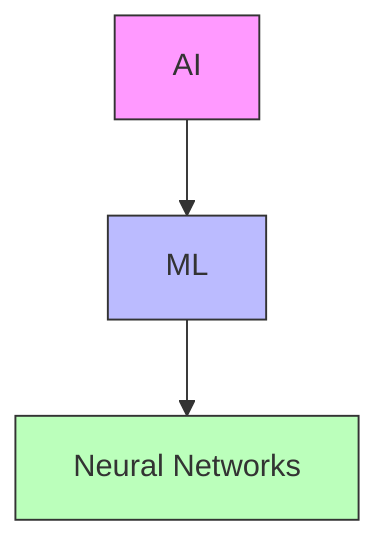
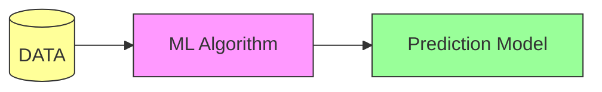
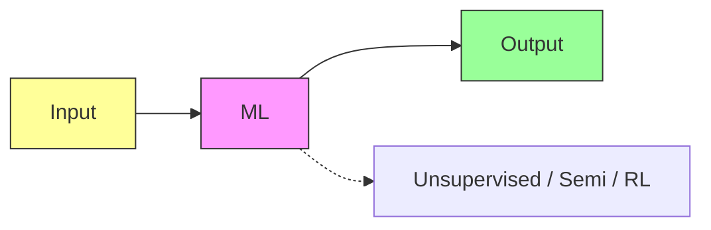
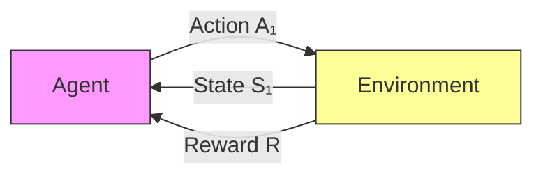

# ML & Neural Networks — Foundations

> [!info] Lecture 1 — 2026-09-21
> CS401 Machine Learning and Neural Networks

## What is ML?

- **Machine Learning** is a subset of [[AI]] (Artificial Intelligence)
- Hierarchy: **AI → ML → Neural Networks**
- ML → branch of AI that learns patterns from data



## Core Pipeline



```
┌─────────┐      ┌──────────────┐      ┌─────────────────┐
│  DATA   │ ───▶ │ ML Algorithm │ ───▶ │ Prediction Model│
└─────────┘      └──────────────┘      └─────────────────┘
```

## Key References

- **Andrew Ng** — prominent ML educator
- **Tom Mitchell** — *Machine Learning* (textbook)
- **Jugal Kalita** — *ML Learning Theory and Practice*

## ML Tasks

- Data exploration
- Data summary / description

## History

- **1949** — Donald Hebb (*Hebbian learning* — foundational to neural networks)

## Input–Output Framework



Learning types:
- **Unsupervised** — no labels
- **Semi-supervised** — partial labels
- **Reinforcement Learning (RL)** — reward-based

### Statistics ↔ ML relationship

```
 ┌───────────┐     ┌───────────┐
 │Statistics │◄───►│    ML     │
 └───────────┘     └───────────┘
       ▲                 ▲
       └────────┬────────┘
          Dynamic Programming
```

## Related Fields

| Field | Relevance to ML |
|---|---|
| Statistics | Probability, distributions, inference |
| Dynamic Programming | Optimisation, sequence problems |
| State Transmission | Modelling state changes |
| Data Mining | Pattern discovery in large datasets |

## Application Example

- ML on tracking health conditions

## Supervised vs Unsupervised Learning

### Supervised Learning

- Uses **labelled** data: features (x) → target (y)
- Tasks: classification, regression
- Example: predicting outcomes from known input-output pairs

```
  y│    ×  ×
   │  ×
   │        ○  ○
   │      ○
   └──────────── x
   (known labels guide the model)
```

### Unsupervised Learning

- Uses **unlabelled** data
- Tasks: clustering, dimensionality reduction
- Example: **customer segmentation** (grouping similar customers)

```
  y│   (○○)    (××)
   │   (○○)    (××)
   │
   └──────────── x
   (no labels — algorithm finds clusters)
```

## Reinforcement Learning (RL)



```
        ┌─────────┐    Action (A₁)    ┌─────────────┐
        │  Agent  │ ───────────────▶  │ Environment │
        └─────────┘                    └─────────────┘
             ▲                              │
             │        State (S₁)            │
             └──────────────────────────────┘
                        ▲
                        │  Reward (R)
```

- Agent takes actions in an environment
- Receives **reward** signals
- Learns a policy to maximise cumulative reward

---

> [!tip] Next lecture
> Fill in the `next` field in frontmatter once the next notes arrive.
