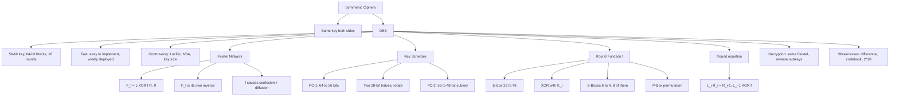

# Symmetric Ciphers & DES

> [!info] Lecture — 2026-10-09
> CS416 Introduction to Cryptography — **Section 2: Symmetric Ciphers**
> Lecturer: Dr. T. Dowling
> Source: `symmetric_1.pdf` (deck dated 2026-10-09)

## Symmetric Ciphers

> [!important] Fundamental point
> **Both parties use the SAME key to encrypt and decrypt.**

```
   Sender ──▶ [ Algorithm ] ──▶ Plaintext ──▶ Ciphertext ──▶ [ Algorithm ] ──▶ Recipient
                                    ▲          10010….011        ▲
                                    │                          │
                                    └──────────── Key ─────────┘
```

### A Note on the Resource

- The material that follows contains a **lot** of information
- It is intended as a **resource** for the lectures
- The material covered **in the lectures** is the basis for using this resource

---

## DES — General Info

- **Keysize too small** (56 bits) — *"50 next year!"* (DES was published 1977, so 2027 marks 50 years)
- **DES cracking machines exist**
  - Keys in about **two days**
  - **AND MUCH LESS!!!**
- Still it survived this long, so it has merit
- **Triple DES** still secure?

---

## "X-bit Security" & Big Numbers

> **Question:** *"Our system has X-bit security"* — X = 64, 128, 256, 512, …
> What does this mean?

### Security Numbers

| System | Key size | Comment |
|---|---|---|
| **DES** | 56 bits | ≈ 7.2 × 10¹⁶ keys (2⁵⁶ = 72,057,594,037,927,936) |
| **AES** | 128 / 192 / 256 bits | |
| **RSA** | 2048 bits | |
| **Atomic Computer** | ~2⁶² bits | Every atom on earth, each doing 10¹⁰ ops/sec |
| **Brute-force passwords** | 400 bits | 50-character ASCII → 50 × 8 bits |

---

## A Bit of Perspective — Travelling Salesman Problem (TSP)

### Problem

- Given **n** cities c₁ … cₙ and an n × n symmetric matrix of distances Dᵢ,ⱼ between cities
- Find an **optimal shortest path visiting each city only once**

### Solutions

| Approach | Complexity | Comment |
|---|---|---|
| **Naïve** | n! | Try all paths, choose the shortest. Works in theory; in practice takes a long time |
| **More efficient** | ~2ⁿ | All need about 2ⁿ operations |

### How long would it take?

Assume **n = 300** and a computer built from every atom on the earth, each atom performing 10¹⁰ operations per second:

| Quantity | Value |
|---|---|
| # seconds since the earth began | < 4.1 × 10¹⁷ |
| # atoms in the earth | < 3.6 × 10⁵¹ |
| # ops our computer can perform | < 1.5 × 10⁷⁹ |
| 2³⁰⁰ | ≈ 2 × 10⁹⁰ |

> If we started when the earth formed we would be **barely started today** — so **TSP with 300 cities is impractical**.

---

## DES Specifications

| Property | Value |
|---|---|
| **Keysize** | 64 bit — really **56 bits** |
| **Type** | Block cipher — acts on blocks of text at a time (64-bit chunks) |
| **Rounds** | 16 — repetitions of a process |
| | *Smaller numbers are significantly more at risk* |
| **Round structure** | Each round is a **Feistel Network (FN)** |

---

## DES Advantages

- **Fast**
- Relatively easy to implement in software/hardware
- Resistant to attacks
- It's in **loads of applications** already
- Even if it's "obsolete" as a standalone it can be used as part of a cryptosystem
  - See public key later

---

## The Controversy

- Evolved from **Lucifer**
- **NSA reduced the key size** and "played" with some of the components
- **Politically suspicious**
  - Allegations of a backdoor for NSA
  - *"They wouldn't do that!"*
  - Still hasn't been found

---

## Feistel Network

### Basic Idea

An FN gives a function guaranteed to be **invertible** and to be **its own inverse**.

**What's the use in that?**

- Don't have to worry about **invertibility**
- Don't have to worry about **calculating the inverse**
- *Remember the Affine cipher?*

### The Formula

Fix $n \in \mathbb{Z}^+$. Given a string of $2n$ bits $(L, R)$ and any function $f : n\text{ bits} \rightarrow n\text{ bits}$:

$$F_f(L, R) = \left(L \oplus f(R),\; R\right)$$

where $\oplus$ denotes XOR.

> **Note that $F_f^{-1} = F_f$.**

```
   Input (L,R)  ──▶  ┌───┐
                     │ f │   (f applied to the RIGHT half)
                     └─┬─┘
                       ▼
   Output F(L,R) = ( L ⊕ f(R), R )
```

### Worked Example — n = 4

Let `string = 10101101`, so $(L, R) = (1010, 1101)$.

Let $f$ be the permutation $(2\ 3)$:

```
   i.e.  1 -> 1
         2 -> 3
         3 -> 2
         4 -> 4      ("missing numbers stay where they are")
```

So $f$ swaps bits 2 and 3 of its input.

| Step | Computation | Result |
|---|---|---|
| $f(R) = f(1101)$ | swap positions 2 and 3 | `1011` |
| $F_f(L,R)$ | $(1010 \oplus 1011,\ 1101)$ | $(0001,\ 1101)$ |
| $F_f(F_f(L,R))$ | $((0001) \oplus f(1101),\ 1101) = ((0001) \oplus (1011),\ 1101)$ | $(1010,\ 1101) = (L, R)$ ✓ |

> [!warning] Error on the slide
> The slide wrote the **first** application as `F_f(L,R) = ((1010) ⊕ (1011), 1101)` — applying $f$ to **L**. It should be **R**: `((1101) ⊕ (1011), 1101)`.
> Check it: $f = (2\ 3)$ swaps positions 2 and 3, so $f(1010) = 1100 \ne 1011$, while $f(1101) = 1011$ ✓. The slide's *own* second line uses $f(1101) = 1011$, so only that first `1010` is a typo.

### The Point

- No matter how **dodgy** $f$ is, we are guaranteed that $F_f$ is invertible and it is its own inverse
- So we can concentrate on making $f$:
  - cause **confusion**
  - cause **diffusion**
- **This is the essence of DES**

---

## Where Does the Key Come In?

- We choose our functions $f$ **at each round to depend on our key**
  - **No key, no $f$, no inverse, no decrypt**
- Each round is an **enhanced version** of a Feistel network

---

## The DES Rounds — Key Schedule

### Step 1: Key Permutation (PC-1)

- Every **8th bit** of the 64-bit key is removed
- The remaining bits are rearranged according to a permutation formula
- This is called the **Key permutation**
- So the 64-bit key is **reduced to 56 bits**

```
64-bit key:   10011101  11101010  11010111  01010100  10111010  11010111  01010100  10111010
              1234567   1234567   1234567   1234567   1234567   1234567   1234567   1234567
                       ↑8        ↑8        ↑8        ↑8        ↑8        ↑8        ↑8    (dropped)
after PC-1:   1001110   1110101   1101011   0101010   1011101   1101011   0101010   1011101
```

**PC-1** (the "57th bit of the key goes in here" annotation on the slide = bit 57 is the first output bit):

```
57 49 41 33 25 17  9  1
58 50 42 34 26 18 10  2
59 51 43 35 27 19 11  3
60 52 44 36
63 55 47 39 31 23 15  7
62 54 46 38 30 22 14  6
61 53 45 37 29 21 13  5
28 20 12  4
```

### Step 2: Key Scheduling (for each round)

- Break the 56-bit key into **two 28-bit halves**
- **Shift each half left by 1 or 2 bits** (with wraparound) — the number of bits depends on the round
- These shifted halves serve as the input to the next round
- Then perform a **Compression permutation**
  - Reduces 56 bits → 48
  - Same formula for each round

**PC-2** (Compression Permutation):

```
14 17 11 24  1  5  3 28 15  6 21 10
23 19 12  4 26  8 16  7 27 20 13  2
41 52 31 37 47 55 30 40 51 45 33 48
44 49 39 56 34 53 46 42 50 36 29 32
```

- The result of these permutations is the **48-bit subkey for each round**
- Seems to have succeeded in **diffusing** and **confusing**
- Next question: how do we use this subkey to encrypt?

---

## Encrypting the Text

- The text block is split into **left and right halves** (32 bits each)
- The text pieces are encrypted from round to round:

$$(L_i,\; R_i) = \left(R_{i-1},\; L_{i-1} \oplus f(K_i,\; R_{i-1})\right)$$

- $f$ depends on the $i$-th subkey
- **Note: the halves of the text are interchanged before being Feisteled**
- *Qu? What do the functions $f$ look like?*

### Graphically

```
              (L_{i-1}, R_{i-1})
                      │
                      ▼
        ┌───────────────────────┐
  K_i ─▶│          f            │
        └───────────────────────┘
                      │
                      ▼
              (L_i, R_i) = ( R_{i-1}, L_{i-1} ⊕ f(K_i, R_{i-1}) )

              ⟲  Iterate 16 times
```

---

## Describing the Functions f

### 1. E-Box (Expansion Permutation)

- At each round $R_{i-1}$ has a fixed **expansion permutation**, or **E-Box**
  - Creates a **48-bit output** (from 32 bits) according to a permutation formula
  - See Garrett for details
- **Why do this?**
  - Creates an **avalanche effect** (Stallings p.73 gives the data)
  - **Messes up Differential Cryptanalysis**

### 2. XOR with the Subkey

- The output from the E-Box is **XOR'ed with the subkey** $K_i$

### 3. S-Boxes (Substitution Boxes)

- Provide the security (**diffusion**)
- **8** of them, applied to the output from the previous step
- Each S-box takes **6 bits** and outputs **4 bits**
- Output from the boxes is combined to form **32 bits**

### 4. P-Box (Final Permutation)

- Finally this 32-bit output has **one more permutation** applied to it, giving $f(K_i, R_{i-1})$

### Testing the Avalanche Claim

| Round | Plaintext pair | Ciphertext pair | Bit difference |
|---|---|---|---|
| 1 | `02468aceeca86420` / `12468aceeca86420` | `3cf03c0fbad22845` / `3cf03c0fbad32845` | **1** (the fourth bit) |
| ……… | | | |
| 16 | `75e8fd8f25896490` / `1ce2e6dc365e5f59` | | **32** |

*Source: Stallings, *Cryptography and Network Security*, 7th edition, p.73*

---

## To Summarize — DES

1. Take a text block and **split it** into $(L, R)$
2. Take the key and **form the subkey for each round**
3. **Send the text through the rounds**
   - Use **E-boxes and S-boxes** to create the functions
   - Use a **Feistel network** from round to round
4. **One final permutation** at the end
5. Output from this is the **ciphertext**

---

## Decryption

- **Initial and final permutations can be reversed**
- **Feistel networks** at each round are applied again to decrypt, using the **same key**
  - **Note:** the subkeys should be used in **reverse order**
    - $K_{16}$ in the first round → $K_1$ in the last round

```
  Encrypt:  K1 → K2 → ... → K16
  Decrypt:  K16 → K15 → ... → K1
```

---

## Remarks

- **S-Boxes were optimised to resist Differential Cryptanalysis**
  - The avalanche effect
- **DES is susceptible to better-than-brute-force attacks**
  - Biham, **key collision attacks**, $2^{28}$
- **Block-by-block encryption is susceptible to a codebook attack**
  - Use **block chaining** in practice

$$
2^{56} = 72{,}057{,}594{,}037{,}927{,}936
\quad\longrightarrow\quad
\text{reduced to } 2^{28} = 268{,}435{,}456
$$

---

## Summary



---

> [!tip] Next lecture
> Fill in the `next` field in frontmatter once the next notes arrive.
