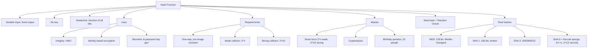

# Hash Functions

> [!info] Lecture — 2026-11-04
> CS416 Introduction to Cryptography — **Section 3/4: Hash Functions**
> Lecturer: Dr. T. Dowling
> Source: `hash_1_2.pdf`, `hash_3.pdf`

## What Is a Hash Function?

- $H(M) \rightarrow h$ — a **fixed-length hash value** from a variable-size input
- **No key involved** (unlike a cipher or MAC)
- The hash is a **function of *all* the bits** of the message — change any bit and the hash changes dramatically (the *avalanche effect*)

| Property | Meaning |
|---|---|
| Input | Any size |
| Output | Fixed length |
| Key | None |
| Sensitive to | Every input bit |

---

## Uses of Hashes

- **Integrity** — the hash of a message is encrypted (symmetric cipher) to give *authentication* without confidentiality
  - No confidentiality, improved performance
  - Later: hash encrypted with a **public key** is the basis of the **digital signature**
- **Identity-Based Encryption** — your email (or any unique string) *is* your key; hashes are integral to key generation
- **Key generation from biometric data** — hashes vital again
- **Password-based encryption** — hashes create entropy and derive a key from a password

---

## The Authentication Problem

> **How do we ensure integrity?**

Authentication attacks:
- **Masquerade** — creating messages and attributing them to someone else (fraudulent acknowledgements)
- **Content modification** — e.g. the ECB and CTR mode attacks on symmetric ciphers
- **Repudiation** — receiver denies receipt / sender denies sending

Message authentication = verify the message comes from the alleged source **and** has not been modified. Methods that counter these attacks are called **digital signatures**.

---

## Authentication Functions — MAC

- **MAC = Message Authentication Code**
- $\text{MAC} = f(\text{message}, \text{key})$
- Serves as an **authenticator** — no encryption here (unlike the hash-encrypted approach)

---

## Notation

| Symbol | Meaning |
|---|---|
| $M$ | Message |
| $H$ | Hash function |
| $h = H(M)$ | Hash value (no key required) |

---

## Requirements for a Good Hash

- $H$ can be applied to data of **any size**
- $H$ produces a **fixed-length output**
- $H$ exhibits an **avalanche effect**
- $H(x)$ is **easy to compute** (hardware & software)
- $H$ is **one-way** — given $h$ it is computationally infeasible to find $x$ with $H(x)=h$
  - tough to *undo* a hash
  - called **pre-image resistance**
- $H$ is **weak collision resistant** — given $x$, infeasible to find $y \neq x$ with $H(x)=H(y)$
  - resists forgery; called **second pre-image resistance**
- $H$ is **strong collision resistant** — infeasible to find *any* pair $(x,y)$ with $H(x)=H(y)$
  - resists **birthday attacks**; called **collision resistance**

---

## Implementation Note — I/O

- **Input** is usually a file or string; high-level languages need **binary**:
  - Java → `ByteArray`
  - Python → `bytes` (`b"String"`)
- **Output** is the same format as input — convert to human-readable with **Base64** or **Hex**

> [!example] Avalanche demo
> Two nearly-identical files give completely different SHA-1 digests:
> - File 1 → `accb764b8d3bc5b1c03114fdc205e45608905232`
> - File 2 → `1f578368c653a360e807d576785c9d4ececef43e`

---

## Collisions & Probability

$$\text{Probability} = \frac{\#\text{favourable}}{\#\text{possible}}$$

For an $n$-bit hash, $\#\text{possible} = 2^n$.

### Weak collision

- Probability of a collision with a **given** message = $1/2^n$
- Need to compute $\sim 2^n$ hashes
- Attacker has little chance here

### Strong collision

- *Many* more possibilities of a collision
- Probability $\approx 1 - e^{-k^2/2^{n+1}}$ → needs $\sim 2^{n/2}$ hashes
- Attacker has **a lot more chance** here — the hash must survive this

---

## Attacks on Hashes

### Brute force

| Resistance | Effort | Usually required? |
|---|---|---|
| Weak collision | $2^n$ | — |
| **Strong collision** | $2^{n/2}$ | **usually required** |

### Typical bit lengths

| Algorithm | Hash size |
|---|---|
| MD5 | 128 bits |
| SHA-1, RIPEMD | 160 bits |
| SHA-2 family | 256 / 384 / 512 bits |

### Cryptanalysis

- Exploit a weakness in the process rather than exhausting all possibilities
- An **ideal** hash requires cryptanalytic effort *greater* than brute force

---

## The Ideal Hash — Random Oracle Model

- A mathematical model of the idealised hash function
- No formula or algorithm — you must *ask the oracle* for $H(x)$
- Like a big random **code book**
- Researchers use the ROM to test algorithms and prove security claims (TCS / formal methods)
- The only efficient way to find $H(x)$ is to actually evaluate it — **no shortcuts**, no matter how many other $H(y)$ you know
  - Counter-example (not ideal): $H(x) = ax+b \bmod n$ can be "inverted" algebraically

---

## The Birthday Paradox

> How many people do you need at a party so the probability that *at least two* share a birthday is $> 0.5$?

**Answer: 23.**

- Probability two people share a birthday with *one given person* is small → needs **253** people for prob 0.5
- Taking people **in pairs** increases the matches — 23 people give $\binom{23}{2} = 253$ pairs
- Same reasoning applies to hashes: it is **much easier to find two messages with the same hash** than to find a message with the same hash as a *given* message

---

## A Real Hash — MD5

- Developed by **Ron Rivest**; most widely used (historically)
- **128-bit** hash (now too small)
- Based on the good hash design objectives; uses the **Merkle–Damgård** compression function

### High-level description

1. **Append padding bits**
2. **Append length**
3. **Initialise MD buffer**
4. **Process message** in 512-bit (16-word) blocks
5. **Output**

### 1. Append padding bits

- Pad so the length is **congruent to 448 mod 512**
- Padding = a `1` followed by the desired number of `0`s
  - e.g. length 950 → pad 10 bits = `1000000000`
- If the message is already $\equiv 448 \bmod 512$, still add 512 bits
- Padding bits range from 1 to 512

### 2. Append length

- Append a **64-bit** representation of the original message length (before padding), least-significant bit first
- If length $> 2^{64}$, use the low-order 64 bits
- Result: message length $\equiv 0 \bmod 512$ (i.e. $L \times 512$ bits)

> [!example] Padding "abc" numerically
> Message `01100001 01100010 01100011` (24 bits) → pad `1` + 423 zeros, then length `24`:
> ```
> 61626380 00000000 00000000 00000000
> 00000000 00000000 00000000 00000000
> 00000000 00000000 00000000 00000000
> 00000000 00000000 00000000 00000018
> ```

### 3. Initialise the MD buffer

128-bit buffer = four 32-bit registers `A, B, C, D` (the **IV** / chaining variables):

| Register | Initial value (hex) |
|---|---|
| A | `67452301` |
| B | `EFCDAB89` |
| C | `98BADCFE` |
| D | `10325476` |

### 4. Process message blocks

- The **compression function** $H_{MD5}$: 4 rounds of compression within (details in Stallings p.272)
- Input: a 512-bit block $Y_i$ + the previous 128-bit output (or the IV on the first block)
- Output: 128-bit value fed to the next stage; the final 128-bit output is the **digest**

### 5. Strength of MD5

- Every hash bit is a function of every message bit (avalanche) — Rivest conjectured $2^{64}$ strong-collision resistance
- **Vulnerable**: attacks on a single 512-bit block were found (can find a block producing the same 128-bit output)
- Also vulnerable to the **birthday attack** (effort $\sim 2^{64}$)
- Conclusion: **need a larger hash value** → 160 bits (SHA, RIPEMD-160)

---

## SHA-1 (Secure Hash Algorithm)

- Padding is **exactly the same** as MD5
- Five 32-bit registers (instead of four)
- Digest = the concatenation: $h_1 \| h_2 \| h_3 \| h_4 \| h_5$

### Attacks on SHA

- SHA-0 is vulnerable
- 2004 (crypto '04): Biham attacked a *simplified* SHA-1
- **Wang, Yin, Yu** (Feb 2005): $2^{80} \to 2^{69}$
- **Wang, Yao, Yao** (Aug 2005): $\to 2^{63}$
- 2020 paper: **"SHA-1 is a Shambles"** — practical attacks (`eprint.iacr.org/2020/014.pdf`)

> [!warning] Recommendation
> As far back as **2006**, NIST told federal agencies to stop using SHA-1 and move to **SHA-256 or higher** (Bitcoin uses SHA-256).

---

## SHA-2 Family

- NIST (April 2006) response to Wang's attack: transition to the **SHA-2** family — SHA-224, SHA-256, SHA-384, SHA-512
- Same general family as SHA-1 (could be attacked similarly) but *much stronger*

---

## SHA-3 — Keccak (the sponge)

- 2007 call for a new hash standard (deadline Oct 2008, modelled on the AES competition)
- **Winner: Keccak** — uses a **sponge function**

### The sponge construction

- **State**: $b = r + c$ bits, initially all zero
  - $r$ = **bitrate**, $c$ = **capacity**
- **Absorbing ("soaking")**: XOR $r$-bit message blocks into the first $r$ bits of state, then apply permutation $f$; repeat for all blocks
- **Squeezing**: output the first $r$ bits, interleaved with applications of $f$; number of blocks chosen by the user
- The last $c$ bits are never XORed with input nor output
- **Security of the sponge construction** = $2^{c/2}$ bits

### The permutation $f$

- Allowed $b$: 25, 50, 100, 200, 400, 800, **1600**
- State = $5 \times 5$ **lanes**, each of $2^l$ bits ($0 \le l \le 6$; $b = 25 \cdot 2^l$)
- Rounds: $12 + 2l$ (so $f[25]$ has 12, $f[1600]$ has 24)
- Each round $R$ is five operations:
  - $\theta$ (theta) — bit mixing
  - $\rho$ (rho) — diffuses between slices
  - $\pi$ (pi) — disturbs vertical/horizontal alignment, mixes within a slice
  - $\chi$ (chi) — non-linear mapping; flips a bit if neighbours exhibit a `01` property
  - $\iota$ (iota) — breaks up symmetry

---

## Salted Hashing

- Used for **password storage**
- Keccak is *not* the best choice — it is **too fast** for password hashing
- See the OWASP Password Storage Cheat Sheet for the current best practice

---

## Summary



---

> [!tip] Next lecture
> Fill in the `next` field in frontmatter once the next notes arrive.
