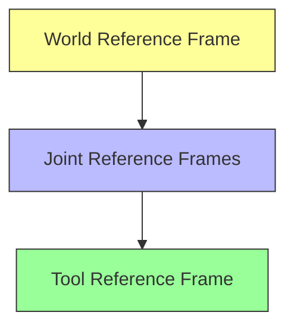

# Introduction to Robotics

> [!info] Lecture 1 — 2026-09-22
> CS422 Robotics & Automation
> Lecturers: Charles Markham, John McDonald

## Module Overview

**Theme**: Introduction to Robotics

| Topic                       |                        |
| --------------------------- | ---------------------- |
| Joint Kinematics            | Robot anatomy & motion |
| Sensors                     | Perception & feedback  |
| Motor Motion Control        | Actuator driving       |
| Control Theory              | Feedback loops         |
| Robot Locomotion            | Movement mechanisms    |
| Mobile Robotics             | Autonomous navigation  |
| ROS                         | Robot Operating System |
| Articulated Motion Planning | Path & trajectory      |

### Assessments

| Component        | Weight  |
| ---------------- | ------- |
| Four Assignments | 20%     |
| Quizzes          | 5%      |
| **Exam**         | **75%** |

### Applications

- Self-driving cars
- Dangerous rescue scenarios
- Difficult task simulation

### Current Bottlenecks

- Data-driven approach
- ML on robotic controls
- Better models on robotics

---

## Asimov's Laws of Robotics

> [!quote] Isaac Asimov
> The three fundamental laws governing robot behaviour.

1. **First Law** — A robot may not injure a human being or, through inaction, allow a human being to come to harm.
2. **Second Law** — A robot must obey the orders given it by human beings except where such orders would conflict with the First Law.
3. **Third Law** — A robot must protect its own existence as long as such protection does not conflict with the First or Second Law.

> [!note] Origin
> The word **"Robot"** was coined by **Karel Čapek** in 1920 (from Czech *robota* = forced labour).

---

## Buying a Robot — Key Specs

| Spec              | Meaning                                             |
| ----------------- | --------------------------------------------------- |
| **Payload**       | Maximum weight the robot can carry                  |
| **Reach**         | Maximum distance from base to end effector          |
| **Precision**     | Accuracy of positioning                             |
| **Repeatability** | Ability to return to the same position consistently |
| **Workspace**     | Volume the robot can operate within                 |

---

## Reference Frames



- **World Reference Frame** — fixed coordinate system for the entire workspace
- **Joint Reference Frames** — local coordinates at each joint
- **Tool Reference Frame** — coordinates relative to the end effector

---

## Robot Anatomy

```
┌──────────────────────────────────────────────┐
│                  CONTROLLER                   │
│         (processing, decision-making)         │
└──────────┬───────────────────────┬────────────┘
           │                       │
     ┌─────▼─────┐          ┌─────▼─────┐
     │  SENSORS  │          │ ACTUATORS │
     │(feedback) │          │ (motors)  │
     └─────┬─────┘          └─────┬─────┘
           │                       │
           ▼                       ▼
     ┌─────────────────────────────────────┐
     │            ENVIRONMENT              │
     └─────────────────────────────────────┘
```

- **Sensors** — provide feedback (position, force, vision)
- **Actuators** — produce motion (motors, hydraulics, pneumatics)
- **Controller** — processes sensor data, computes commands

---

## Joint Types & Degrees of Freedom

### Joint Pairs

| Joint Type | DOF (F) | Motion |
|---|---|---|
| **Revolute pair** | 1 | Rotation about a single axis |
| **Prismatic pair** | 1 | Linear sliding (translation) |
| **Cylindrical pair** | 2 | Rotation + translation along same axis |
| **Planar pair** | 1 | 2D planar motion (x, y, rotation) |
| **Spherical pair** | 3 | Ball-and-socket (3 rotational DOF) |

```
Revolute pair (F=1)      Cylindrical pair (F=2)
    ╲                      ╲━━━╲
     ●                       ●───●
    ╱                      ╱━━━╱

Prismatic pair (F=1)     Spherical pair (F=3)
  ┌──┐                    ╭───╮
  │  │━━▶                  │ ● │
  └──┘                    ╰───╯
```

### Degree of Freedom (F) vs Mobility (M)

- **F** — degrees of freedom of a single joint
- **M** — mobility of the entire mechanism (total DOF)

| System | M |
|---|---|
| Free body in space | 6 |
| R-F pair (revolute) | M=1, F=4 |

---

## Grübler's Equation

> [!important] Grübler's Formula
> Calculates the **mobility** (degrees of freedom) of a planar kinematic chain.

```
      ○─────○─────○─────○
     ╱                   ╲
    ○                     ○
   ╱                       ╲
  △ (Fixed/Ground)
```

### Formula

$$M = 6(N - 1) - \sum_{i=1}^{G}(6 - f_i)$$

Where:
- **M** = mobility (total DOF of mechanism)
- **N** = number of links (including ground)
- **G** = number of joints
- **fᵢ** = degrees of freedom of joint *i*

### Intuition

- A free body in 3D space has **6 DOF** (3 translation + 3 rotation)
- Each joint **reduces** DOF by `(6 - fᵢ)`
- The ground link is fixed, so we subtract 1 from N

### Example

For a **4-bar linkage**:
- N = 4 links (3 moving + 1 ground)
- G = 4 revolute joints (each fᵢ = 1)

$$M = 6(4-1) - 4(6-1) = 18 - 20 = -2$$

> [!note]
> For **planar** mechanisms, use the simplified form:
> $$M = 3(N-1) - 2G$$
> For the 4-bar linkage: M = 3(3) - 2(4) = 9 - 8 = **1** ✓

---

## Grübler's Equation (2D) — Worked Examples

For planar mechanisms, the mobility is:

$$M = 3(N - G - 1) + \sum_{i=1}^{G} f_i$$

For **revolute joints only** (fᵢ = 1), this simplifies to:

$$M = 3N - 2G - 3$$

### Example — 4-Bar Linkage

```
        G2
       ╱  ╲
     L2    L3
     ╱      ╲
   G1   L4   G4
   ║   ────  ║
   L1 (Fixed) 
```

- N = 4, G = 4, all revolute (fᵢ = 1)
- M = 3(4 - 4 - 1) + (1+1+1+1) = -3 + 4 = **1 DOF**

One input (e.g., motor on one joint) fully determines the mechanism's position.

### Rigid Structures (M = 0)

| Config | N | G | M | Result |
|---|---|---|---|---|
| Triangle | 3 | 3 | 0 | Rigid |
| 4-bar (special) | 4 | 4 | 0 | Rigid |
| 5-link, 6-joint | 5 | 6 | 0 | Rigid |

When M = 0, the structure is **rigid** — no relative motion possible.

---

## Walking Mechanisms

### Jansen Linkage (1 leg)

A famous **leg mechanism** invented by Theo Jansen for his "Strandbeest" sculptures.

- **N = 8 links**, **G = 10 pairs** (all revolute, fᵢ = 1)
- M = 3(8 - 10 - 1) + 10 = -9 + 10 = **1 DOF**

| Property | Value |
|---|---|
| Crank rotation | 120° per stride |
| Legs needed | 3 (replaces one wheel) |
| Crank direction | Counterclockwise |

```
         6
        ╱ ╲
      4     3
     ╱       ╲
    7    4,5  2,3
     ╲   │   ╱
      5  │  1
       ╲ │ ╱
        9,10
         │
         8
         │
    (foot trajectory)
```

The foot traces an oval-like path, producing a walking gait.

### Klann Linkage (1 leg)

Another walking mechanism — more compact than Jansen.

- **N = 6 links**, **G = 7 pairs** (all revolute, fᵢ = 1)
- M = 3(6 - 7 - 1) + 7 = -6 + 7 = **1 DOF**

```
        6
       ╱ ╲
     5     5
     ╱       ╲
    7    4    1
     ╲  │   ╱
      3 │  2
       ╲│╱
     (crank)
```

The foot trajectory is similar to Jansen but with fewer links.

### Comparison

| Mechanism | Links | Joints | DOF | Complexity |
|---|---|---|---|---|
| Jansen | 8 | 10 | 1 | High (more realistic gait) |
| Klann | 6 | 7 | 1 | Lower (simpler construction) |

Both produce **1 DOF** — a single motor drives the entire leg.

---

## Over-Constrained Systems

Grübler's equation sometimes **fails** — predicting M = 0 (rigid) when the mechanism actually moves.

### Sarrus Linkage

- N = 6, G = 6, fᵢ = 1
- M = 3(6 - 6 - 1) + 6 = -6 + 6 = **0** (predicted rigid)
- **Actually moves with M = 1!**

Converts rotational motion into pure linear translation. The equation fails because of special geometric symmetry.

### Bennett's Linkage

- N = 4, G = 4, fᵢ = 1
- M = 3(4 - 4 - 1) + 4 = -6 + 4 = **-2** (predicted impossible)
- **Actually moves with M = 1!**

A 4-bar spatial linkage that works despite the negative prediction. Special geometric conditions (equal opposite link lengths, specific twist angles) allow motion.

> [!warning] Limitation of Grübler's
> Grübler's equation assumes **general** geometry. Over-constrained mechanisms exploit special symmetries that the formula doesn't account for.

---

## Stewart Platform (Parallel Robot)

A **6-DOF parallel manipulator** — the platform can move in all 6 degrees of freedom.

- **N = 14 links**, **G = 18 pairs**
- Joints: 12 universal joints (2 DOF each) + 6 cylindrical joints (2 DOF each)
- fᵢ contribution: 12×2 + 6×2 = 24 + 12 = 36

$$M = 6(N - G - 1) + \sum f_i$$

$$M = 6(14 - 18 - 1) + 36 = -30 + 36 = 6 \text{ DOF}$$

> [!note] 3D Formula
> For spatial (3D) mechanisms, the base multiplier is **6** (not 3 as in 2D), since each link has 6 DOF in 3D space.

### Applications

- Flight simulators
- Precision machining
- Medical robotics (surgery platforms)
- Telescope positioning

---

> [!tip] Next lecture
> Robot Arm Configurations, Inverse Kinematics, and Denavit–Hartenberg Convention.
