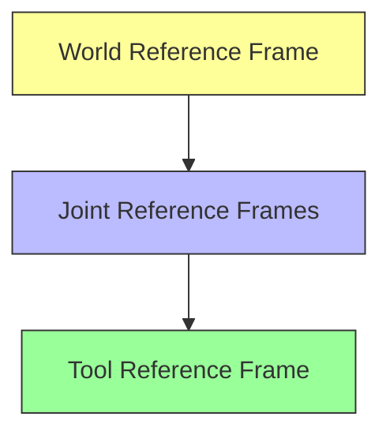

# Introduction to Robotics

> [!info] Lecture 1 — 2026-09-22
> CS422 Robotics & Automation
> Lecturers: Charles Markham, John McDonald

## Module Overview

**Theme**: Introduction to Robotics

| Topic                       |                        |
| --------------------------- | ---------------------- |
| Joint Kinematics            | Robot anatomy & motion |
| Sensors                     | Perception & feedback  |
| Motor Motion Control        | Actuator driving       |
| Control Theory              | Feedback loops         |
| Robot Locomotion            | Movement mechanisms    |
| Mobile Robotics             | Autonomous navigation  |
| ROS                         | Robot Operating System |
| Articulated Motion Planning | Path & trajectory      |

### Assessments

| Component        | Weight  |
| ---------------- | ------- |
| Four Assignments | 20%     |
| Quizzes          | 5%      |
| **Exam**         | **75%** |

### Applications

- Self-driving cars
- Dangerous rescue scenarios
- Difficult task simulation

### Current Bottlenecks

- Data-driven approach
- ML on robotic controls
- Better models on robotics

---

## Asimov's Laws of Robotics

> [!quote] Isaac Asimov
> The three fundamental laws governing robot behaviour.

1. **First Law** — A robot may not injure a human being or, through inaction, allow a human being to come to harm.
2. **Second Law** — A robot must obey the orders given it by human beings except where such orders would conflict with the First Law.
3. **Third Law** — A robot must protect its own existence as long as such protection does not conflict with the First or Second Law.

> [!note] Origin
> The word **"Robot"** was coined by **Karel Čapek** in 1920 (from Czech *robota* = forced labour).

---

## Buying a Robot — Key Specs

| Spec              | Meaning                                             |
| ----------------- | --------------------------------------------------- |
| **Payload**       | Maximum weight the robot can carry                  |
| **Reach**         | Maximum distance from base to end effector          |
| **Precision**     | Accuracy of positioning                             |
| **Repeatability** | Ability to return to the same position consistently |
| **Workspace**     | Volume the robot can operate within                 |

---

## Reference Frames



- **World Reference Frame** — fixed coordinate system for the entire workspace
- **Joint Reference Frames** — local coordinates at each joint
- **Tool Reference Frame** — coordinates relative to the end effector

---

## Robot Anatomy

```
┌──────────────────────────────────────────────┐
│                  CONTROLLER                   │
│         (processing, decision-making)         │
└──────────┬───────────────────────┬────────────┘
           │                       │
     ┌─────▼─────┐          ┌─────▼─────┐
     │  SENSORS  │          │ ACTUATORS │
     │(feedback) │          │ (motors)  │
     └─────┬─────┘          └─────┬─────┘
           │                       │
           ▼                       ▼
     ┌─────────────────────────────────────┐
     │            ENVIRONMENT              │
     └─────────────────────────────────────┘
```

- **Sensors** — provide feedback (position, force, vision)
- **Actuators** — produce motion (motors, hydraulics, pneumatics)
- **Controller** — processes sensor data, computes commands

---

## Joint Types & Degrees of Freedom

### Joint Pairs

| Joint Type | DOF (F) | Motion |
|---|---|---|
| **Revolute pair** | 1 | Rotation about a single axis |
| **Prismatic pair** | 1 | Linear sliding (translation) |
| **Cylindrical pair** | 2 | Rotation + translation along same axis |
| **Planar pair** | 1 | 2D planar motion (x, y, rotation) |
| **Spherical pair** | 3 | Ball-and-socket (3 rotational DOF) |

```
Revolute pair (F=1)      Cylindrical pair (F=2)
    ╲                      ╲━━━╲
     ●                       ●───●
    ╱                      ╱━━━╱

Prismatic pair (F=1)     Spherical pair (F=3)
  ┌──┐                    ╭───╮
  │  │━━▶                  │ ● │
  └──┘                    ╰───╯
```

### Degree of Freedom (F) vs Mobility (M)

- **F** — degrees of freedom of a single joint
- **M** — mobility of the entire mechanism (total DOF)

| System | M |
|---|---|
| Free body in space | 6 |
| R-F pair (revolute) | M=1, F=4 |

---

## Grübler's Equation

> [!important] Grübler's Formula
> Calculates the **mobility** (degrees of freedom) of a planar kinematic chain.

```
      ○─────○─────○─────○
     ╱                   ╲
    ○                     ○
   ╱                       ╲
  △ (Fixed/Ground)
```

### Formula

$$M = 6(N - 1) - \sum_{i=1}^{G}(6 - f_i)$$

Where:
- **M** = mobility (total DOF of mechanism)
- **N** = number of links (including ground)
- **G** = number of joints
- **fᵢ** = degrees of freedom of joint *i*

### Intuition

- A free body in 3D space has **6 DOF** (3 translation + 3 rotation)
- Each joint **reduces** DOF by `(6 - fᵢ)`
- The ground link is fixed, so we subtract 1 from N

### Example

For a **4-bar linkage**:
- N = 4 links (3 moving + 1 ground)
- G = 4 revolute joints (each fᵢ = 1)

$$M = 6(4-1) - 4(6-1) = 18 - 20 = -2$$

> [!note]
> For **planar** mechanisms, use the simplified form:
> $$M = 3(N-1) - 2G$$
> For the 4-bar linkage: M = 3(3) - 2(4) = 9 - 8 = **1** ✓

---

> [!tip] Next lecture
> Fill in the `next` field in frontmatter once the next notes arrive.
