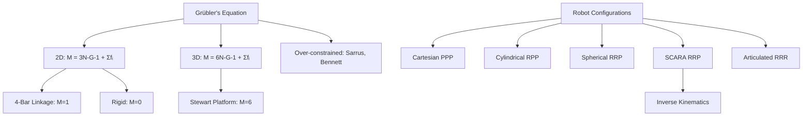

# Robotics — Linkages, Mechanisms & Kinematics

> [!info] Lecture — 2026-09-28
> CS422 Robotics & Automation

## Grübler's Equation (2D)

For planar mechanisms, the mobility (degrees of freedom) is:

$$M = 3(N - G - 1) + \sum_{i=1}^{G} f_i$$

| Variable | Meaning |
|---|---|
| N | Number of links (including ground/frame) |
| G | Number of joints (pairs) |
| M | Mobility (DOF) |
| fᵢ | Degrees of freedom of joint i |

For **revolute joints only** (fᵢ = 1), this simplifies to:

$$M = 3(N - G - 1) + G = 3N - 2G - 3$$

### Example — 4-Bar Linkage

```
        G2
       ╱  ╲
     L2    L3
     ╱      ╲
   G1   L4   G4
   ║   ────  ║
   L1 (Fixed) 
```

- N = 4, G = 4, all revolute (fᵢ = 1)
- M = 3(4 - 4 - 1) + (1+1+1+1) = -3 + 4 = **1 DOF**

One input (e.g., motor on one joint) fully determines the mechanism's position.

### Rigid Structures (M = 0)

| Config | N | G | M | Result |
|---|---|---|---|---|
| Triangle | 3 | 3 | 0 | Rigid |
| 4-bar (special) | 4 | 4 | 0 | Rigid |
| 5-link, 6-joint | 5 | 6 | 0 | Rigid |

When M = 0, the structure is **rigid** — no relative motion possible.

---

## Walking Mechanisms

### Jansen Linkage (1 leg)

A famous **leg mechanism** invented by Theo Jansen for his "Strandbeest" sculptures.

- **N = 8 links**, **G = 10 pairs** (all revolute, fᵢ = 1)
- M = 3(8 - 10 - 1) + 10 = -9 + 10 = **1 DOF**

| Property | Value |
|---|---|
| Crank rotation | 120° per stride |
| Legs needed | 3 (replaces one wheel) |
| Crank direction | Counterclockwise |

```
         6
        ╱ ╲
      4     3
     ╱       ╲
    7    4,5  2,3
     ╲   │   ╱
      5  │  1
       ╲ │ ╱
        9,10
         │
         8
         │
    (foot trajectory)
```

The foot traces an oval-like path, producing a walking gait.

### Klann Linkage (1 leg)

Another walking mechanism — more compact than Jansen.

- **N = 6 links**, **G = 7 pairs** (all revolute, fᵢ = 1)
- M = 3(6 - 7 - 1) + 7 = -6 + 7 = **1 DOF**

```
        6
       ╱ ╲
     5     5
     ╱       ╲
    7    4    1
     ╲  │   ╱
      3 │  2
       ╲│╱
     (crank)
```

The foot trajectory is similar to Jansen but with fewer links.

### Comparison

| Mechanism | Links | Joints | DOF | Complexity |
|---|---|---|---|---|
| Jansen | 8 | 10 | 1 | High (more realistic gait) |
| Klann | 6 | 7 | 1 | Lower (simpler construction) |

Both produce **1 DOF** — a single motor drives the entire leg.

---

## Over-Constrained Systems

Grübler's equation sometimes **fails** — predicting M = 0 (rigid) when the mechanism actually moves. These are called **over-constrained** mechanisms.

### Sarrus Linkage

- N = 6, G = 6, fᵢ = 1
- M = 3(6 - 6 - 1) + 6 = -6 + 6 = **0** (predicted rigid)
- **Actually moves with M = 1!**

The mechanism converts rotational motion into pure linear translation. The equation fails because of special geometric symmetry.

### Bennett's Linkage

- N = 4, G = 4, fᵢ = 1
- M = 3(4 - 4 - 1) + 4 = -6 + 4 = **-2** (predicted impossible)
- **Actually moves with M = 1!**

A 4-bar spatial linkage that works despite the negative prediction. The special geometric conditions (equal opposite link lengths, specific twist angles) allow motion.

> [!warning] Limitation of Grübler's
> Grübler's equation assumes **general** geometry. Over-constrained mechanisms exploit special symmetries that the formula doesn't account for.

---

## Stewart Platform (Parallel Robot)

A **6-DOF parallel manipulator** — the platform can move in all 6 degrees of freedom (3 translations + 3 rotations).

- **N = 14 links**, **G = 18 pairs**
- Joints: 12 universal joints (2 DOF each) + 6 cylindrical joints (2 DOF each)
- fᵢ contribution: 12×2 + 6×2 = 24 + 12 = 36

$$M = 6(N - G - 1) + \sum f_i$$

$$M = 6(14 - 18 - 1) + 36 = -30 + 36 = 6 \text{ DOF}$$

> [!note] 3D Formula
> For spatial (3D) mechanisms, the base multiplier is **6** (not 3 as in 2D), since each link has 6 DOF in 3D space.

### Applications

- Flight simulators
- Precision machining
- Medical robotics (surgery platforms)
- Telescope positioning

---

## Robot Arm Configurations

Physical 3D-printed models demonstrating the main robot arm types:

### 1. Cartesian (PPP)

```
    Z
    │
    ├── Linear joint
    │
    ├── Linear joint
    │
    └── Linear joint ─── X
           │
           Y
```

- **Joints**: 3 prismatic (linear)
- **Workspace**: Rectangular (box-shaped)
- **Advantages**: Simple kinematics, high rigidity
- **Disadvantages**: Large footprint, limited dexterity

### 2. Cylindrical (RPP)

```
    Z
    │
    ├── Prismatic (vertical)
    │
    ├── Prismatic (radial)
    │
    └── Revolute (base rotation) ─── X
```

- **Joints**: 1 revolute + 2 prismatic
- **Workspace**: Cylinder
- **Applications**: Assembly, pick-and-place

### 3. Spherical / Polar (RRP)

```
    Z
    │
    ├── Prismatic (extend)
    │
    ├── Revolute (elevation)
    │
    └── Revolute (azimuth) ─── X
```

- **Joints**: 2 revolute + 1 prismatic
- **Workspace**: Spherical shell
- **Applications**: Injection moulding, machine loading

### 4. SCARA (RRP)

**Selective Compliant Articulated Robot Arm** (or Assembly Robot Arm)

```
    Z (vertical, compliant)
    │
    ├── Revolute (θ₂)
    │
    ├── Revolute (θ₁)
    │
    └── Base ─── X
```

- **Joints**: 2 revolute (parallel axes) + 1 prismatic (vertical)
- **Workspace**: Annular (donut-shaped)

**Forward kinematics**:

$$x = L_1 \cos\theta_1 + L_2 \cos(\theta_1 + \theta_2)$$
$$y = L_1 \sin\theta_1 + L_2 \sin(\theta_1 + \theta_2)$$
$$z = z$$

| Task | Suitability |
|---|---|
| Pick and place | ★★★★★ |
| Sorting | ★★★★ |
| Drilling | ★★★ |
| Screw driving | ★★★ |
| Insertion | ★★★★ |

**Advantages**: Fast, precise, rigid vertically (good for assembly), compliant horizontally (gentle on parts).

### 5. Articulated (RRR)

```
    Z
    │
    ├── Revolute (wrist)
    │
    ├── Revolute (elbow)
    │
    ├── Revolute (shoulder)
    │
    └── Base ─── X
```

- **Joints**: 3+ revolute
- **Workspace**: Complex (large, dexterous)
- **Applications**: Welding, painting, surgery

---

## Inverse Kinematics — Articulated Robot

Given a target position (X, Y, Z), find the joint angles (θ₁, θ₂, φ).

### Setup

- Link lengths: L₁, L₂
- Target: (X, Y, Z)
- r = horizontal distance = √(X² + Y²)
- c = total distance = √(r² + Z²)

### Solution

$$\phi = \tan^{-1}\left(\frac{Y}{X}\right)$$

$$A = \cos^{-1}\left[\frac{L_2^2 + c^2 - L_1^2}{2 L_2 c}\right]$$

$$B = \sin^{-1}\left[\frac{L_2 \sin A}{L_1}\right]$$

$$\theta_1 = \tan^{-1}\left(\frac{Z}{r}\right) - B$$

$$\theta_2 = A + B$$

> [!note] Multiple Solutions
> Inverse kinematics often has **multiple solutions** (e.g., "elbow up" vs "elbow down"). The choice depends on the application and collision constraints.

---

## Summary



---

> [!tip] Next lecture
> Fill in the `next` field in frontmatter once the next notes arrive.
