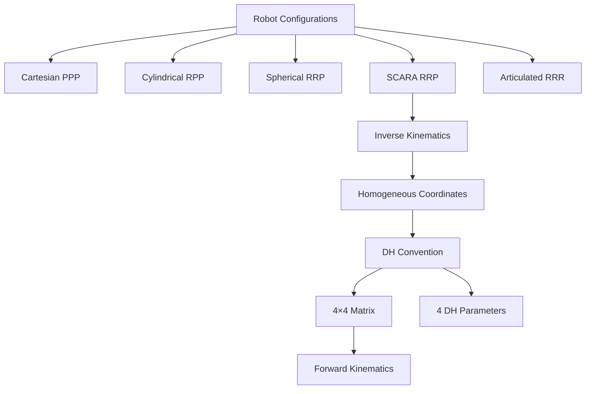

# Robotics — Configurations, Kinematics & DH Convention

> [!info] Lecture — 2026-09-28
> CS422 Robotics & Automation

## Robot Arm Configurations

Physical 3D-printed models demonstrating the main robot arm types:

### 1. Cartesian (PPP)

```
    Z
    │
    ├── Linear joint
    │
    ├── Linear joint
    │
    └── Linear joint ─── X
           │
           Y
```

- **Joints**: 3 prismatic (linear)
- **Workspace**: Rectangular (box-shaped)
- **Advantages**: Simple kinematics, high rigidity
- **Disadvantages**: Large footprint, limited dexterity

### 2. Cylindrical (RPP)

```
    Z
    │
    ├── Prismatic (vertical)
    │
    ├── Prismatic (radial)
    │
    └── Revolute (base rotation) ─── X
```

- **Joints**: 1 revolute + 2 prismatic
- **Workspace**: Cylinder
- **Applications**: Assembly, pick-and-place

### 3. Spherical / Polar (RRP)

```
    Z
    │
    ├── Prismatic (extend)
    │
    ├── Revolute (elevation)
    │
    └── Revolute (azimuth) ─── X
```

- **Joints**: 2 revolute + 1 prismatic
- **Workspace**: Spherical shell
- **Applications**: Injection moulding, machine loading

### 4. SCARA (RRP)

**Selective Compliant Articulated Robot Arm** (or Assembly Robot Arm)

```
    Z (vertical, compliant)
    │
    ├── Revolute (θ₂)
    │
    ├── Revolute (θ₁)
    │
    └── Base ─── X
```

- **Joints**: 2 revolute (parallel axes) + 1 prismatic (vertical)
- **Workspace**: Annular (donut-shaped)

**Forward kinematics**:

$$x = L_1 \cos\theta_1 + L_2 \cos(\theta_1 + \theta_2)$$
$$y = L_1 \sin\theta_1 + L_2 \sin(\theta_1 + \theta_2)$$
$$z = z$$

| Task | Suitability |
|---|---|
| Pick and place | ★★★★★ |
| Sorting | ★★★★ |
| Drilling | ★★★ |
| Screw driving | ★★★ |
| Insertion | ★★★★ |

**Advantages**: Fast, precise, rigid vertically (good for assembly), compliant horizontally (gentle on parts).

### 5. Articulated (RRR)

```
    Z
    │
    ├── Revolute (wrist)
    │
    ├── Revolute (elbow)
    │
    ├── Revolute (shoulder)
    │
    └── Base ─── X
```

- **Joints**: 3+ revolute
- **Workspace**: Complex (large, dexterous)
- **Applications**: Welding, painting, surgery

### Configuration Comparison

| Type | Joints | Workspace | Best For |
|---|---|---|---|
| Cartesian | PPP | Box | Simple pick-place |
| Cylindrical | RPP | Cylinder | Assembly |
| Spherical | RRP | Sphere shell | Machine loading |
| SCARA | RRP | Annular | High-speed assembly |
| Articulated | RRR | Complex | Dexterity tasks |

---

## Inverse Kinematics — Articulated Robot

Given a target position (X, Y, Z), find the joint angles (θ₁, θ₂, φ).

### Setup

- Link lengths: L₁, L₂
- Target: (X, Y, Z)
- r = horizontal distance = √(X² + Y²)
- c = total distance = √(r² + Z²)

### Solution

$$\phi = \tan^{-1}\left(\frac{Y}{X}\right)$$

$$A = \cos^{-1}\left[\frac{L_2^2 + c^2 - L_1^2}{2 L_2 c}\right]$$

$$B = \sin^{-1}\left[\frac{L_2 \sin A}{L_1}\right]$$

$$\theta_1 = \tan^{-1}\left(\frac{Z}{r}\right) - B$$

$$\theta_2 = A + B$$

> [!note] Multiple Solutions
> Inverse kinematics often has **multiple solutions** (e.g., "elbow up" vs "elbow down"). The choice depends on the application and collision constraints.

---

## Homogeneous Coordinates

Before understanding the DH matrix, we need to understand **homogeneous coordinates** — the mathematical trick that makes combining rotation and translation possible.

### The Problem

In standard 3D coordinates, a vector is:

$$\mathbf{v} = a\mathbf{i} + b\mathbf{j} + c\mathbf{k}$$

where **i**, **j**, **k** are unit vectors along the X, Y, Z axes.

But **rotations** are 3×3 matrix multiplications, while **translations** are additions. You can't combine them into a single matrix operation in 3D.

### The Solution — Add a Fourth Coordinate

Represent the 3D vector as a **4D vector** with w = 1:

```
    ┌   ┐
    │ x │
v = │ y │      where a = x/w, b = y/w, c = z/w
    │ z │
    │ w │      W = scaling factor, typically 1
    └   ┘
```

```
        ck
        │
    bj ─┤
        │    ╱ v
        │   ╱
        │  ╱
        │ ╱
    ────┼──── ai
       ╱│
      ╱ │
```

### Why This Works

| Operation | 3D (impossible to combine) | 4D Homogeneous (single matrix) |
|---|---|---|
| Rotation | 3×3 matrix multiply | 4×4 matrix multiply |
| Translation | Vector addition (+t) | 4×4 matrix multiply |
| **Both** | Two separate operations | **One 4×4 matrix multiply** |

With homogeneous coordinates, both rotation and translation become **matrix multiplications**, so a chain of transforms collapses into a single matrix product:

$$T = R \cdot T_{translate} \cdot R' \cdot T' \cdot \ldots$$

### Converting Back

To get the 3D coordinates back, divide by w:

$$a = \frac{x}{w}, \quad b = \frac{y}{w}, \quad c = \frac{z}{w}$$

For points (w = 1), the coordinates are just (x, y, z). For direction vectors, w = 0 (points at infinity).

> [!tip] Key Insight
> Homogeneous coordinates turn **rotation + translation** (two different operations) into **just matrix multiplication** (one operation). This is why the DH matrix is 4×4 instead of 3×3.

---

## Denavit–Hartenberg (DH) Convention

The standard tool for describing how one joint of a robot arm is positioned relative to the next.

### The Problem

A robot arm is a chain of links. Each joint has its own coordinate frame. If a point has coordinates in frame 2, what are its coordinates in frame 1? **Multiply by a single 4×4 matrix.**

### Why 4×4? — Homogeneous Coordinates

Rotations are 3×3 matrices, but **translations** (shifting position) can't be expressed as 3×3 matrix multiplication. Adding a fourth coordinate fixed at 1 makes translation expressible as a matrix multiply too.

```
[x]       [x']      [  R  | t ]   [x]
[y]   →   [y']  =   [-----+---] · [y]
[z]       [z']      [ 0 0 0  1]   [z]
[1]       [1']                      [1]
```

- **Top-left 3×3** (R): rotation
- **Right column** (t): translation
- **Bottom row** (0 0 0 1): always the same, keeps homogeneous form

Once rotation and translation are both matrices, a whole sequence of moves collapses into one matrix product.

### Reading the DH Matrix (Right to Left)

Each joint transform is built from three operations:

```
[x]₁       [x]₂
[y]   = rotZ(θ) · tran(L, 0, D) · rotX(α) · [y]
[z]₁       [z]₂
[1]₁       [1]₂
```

| Operation | What it does |
|---|---|
| `rotX(α)` | Rotate about x-axis by α (twist between joint axes) |
| `tran(L, 0, D)` | Shift by L along x (link length) and D along z (offset) |
| `rotZ(θ)` | Rotate about z-axis by θ (joint angle — the motor-controlled variable) |

> [!note] Notation
> Cθ = cos θ, Sθ = sin θ, Cα = cos α, Sα = sin α

### The Three Matrices

**rotZ(θ)** — rotation about z-axis:

```
┌              ┐
│ Cθ   -Sθ  0  0 │
│ Sθ    Cθ  0  0 │
│  0     0  1  0 │
│  0     0  0  1 │
└              ┘
```

**tran(L, 0, D)** — translation:

```
┌              ┐
│ 1   0   0  L │
│ 0   1   0  0 │
│ 0   0   1  D │
│ 0   0   0  1 │
└              ┘
```

**rotX(α)** — rotation about x-axis:

```
┌              ┐
│ 1   0    0   0 │
│ 0  Cα  -Sα   0 │
│ 0  Sα   Cα   0 │
│ 0   0    0   1 │
└              ┘
```

> [!warning] Error on the slide
> The slide showed the first row of `rotX(α)` as `0 0 0 0`, but it should be `1 0 0 0`. Rotating about x leaves x unchanged, so that corner must be 1. The boxed final DH matrix is correct — the multiplication checks out.

### The Full DH Matrix (Result)

Multiplying all three gives:

```
┌                                          ┐
│  Cθ    -Sθ·Cα    Sθ·Sα    L·Cθ         │
│  Sθ     Cθ·Cα   -Cθ·Sα    L·Sθ         │
│   0      Sα       Cα       D            │
│   0       0        0       1            │
└                                          ┘
```

**How to read it:**

| Block | Meaning |
|---|---|
| Top-left 3×3 | Combined rotation — orientation of frame 2 relative to frame 1 |
| Right column (LCθ, LSθ, D) | Translation — where frame 2's origin sits in frame 1 |
| Bottom row (0 0 0 1) | Homogeneous padding (always the same) |

### The Four DH Parameters

Each joint is described by just **four numbers**:

| Parameter | Symbol | Meaning |
|---|---|---|
| Joint angle | θ | Rotation about z-axis (motor-controlled) |
| Link offset | D | Translation along z-axis |
| Link length | L | Translation along x-axis |
| Link twist | α | Rotation about x-axis |

### Forward Kinematics — Chaining Matrices

For an n-joint arm, multiply all matrices together:

$$T_{0n} = T_{01} \cdot T_{12} \cdot T_{23} \cdot \ldots \cdot T_{(n-1)n}$$

This tells you **exactly where the end of the arm (gripper)** is for any set of joint angles.

```
T₀₁ · T₁₂ · T₂₃ = T₀₃ (end effector position)
```

---

## Summary



---

> [!tip] Next lecture
> Fill in the `next` field in frontmatter once the next notes arrive.
