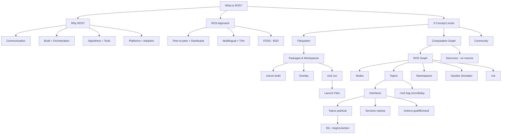

# Introduction to ROS

> [!info] Lecture — 2026-10-13
> CS422 Robotics & Automation
> Lecturers: John McDonald, Charles Markham
> Source: `ROS2.pdf` (71 slides, Maynooth Dept. of Computer Science)

## What is ROS?

**ROS** = **R**obot **O**perating **S**ystem

A **research/industrial grade framework** for building **modular and reusable** software components for robotics.

Think of it as the *middleware + build system + tooling + standard library* layer that sits between your robot's hardware and your algorithms.

### Recommended Reading

| Source | Link |
|---|---|
| ROS 2 Official Docs | https://docs.ros.org/en/lyrical/index.html |
| CS231n Stanford Python/NumPy Tutorial | http://cs231n.github.io/python-numpy-tutorial/ |
| SciPy Lecture Notes (§1.1–1.4) | https://lectures.scientific-python.org/ |

---

## Why ROS?

The slides build this list up one bullet at a time:

1. **Versatile communication** — ROS Interfaces (Topics, Services, Actions)
2. **Build system**
3. **Orchestration**
4. **Configuration / Deployment**
5. **Out-of-the-box algorithms / libraries** — Transformations, Mapping, Planning
6. **Tools** — for navigating, visualising, plotting, logging
7. **Platforms**
8. **Adoption / User base**

> [!tip] Core value proposition
> ROS gives you *communication + build + orchestration + deployment + algorithms + tools + platforms* in one coherent ecosystem, rather than bolting them together yourself.

---

## The ROS Approach

Two columns of design principles:

| Principle | Meaning |
|---|---|
| **Framework for writing robot software** | Tools, libraries and conventions usable across a wide variety of robotic platforms |
| **Built with collaboration in mind** | Modular package-based deployment; packages can come from different sources, since different expertise resides in different locations |
| **Peer to peer** | ROS system = numerous small programs exchanging messages over efficient communication mechanisms |
| **Distributed** | Seamless support for distributed computing |
| **Tools based** | A myriad of tools for navigating and building the source tree, visualising communication patterns, plotting data streams, logging data |
| **Multilingual** | Client libraries for C++, Python, LISP, Java, JavaScript, Matlab, Ruby, Haskell, R, and others |
| **Thin** | Wraps stand-alone libraries in a thin communication layer so they can message-pass to other ROS modules |
| **Free and Open Source** | Core system and many packages released under BSD — plays nice with both research and commercial software |

> [!note] "Thin" matters
> Because ROS only adds a *thin* communication layer on top of existing libraries, you can port your own algorithms in without rewriting them.

---

## ROS Versions

The slides plot **ROS 1 vs ROS 2** against the **Ubuntu** version — each ROS release is tied to a specific Ubuntu LTS:

| Ubuntu | ROS distribution | Notes |
|---|---|---|
| 20.04 | **ROS 1** (Noetic) | Last ROS 1 release, EOL'd |
| 22.04 | **ROS 2** | Humble |
| 24.04 | **ROS 2** | Jazzy Jalisco |
| 26.04 | **ROS 2** | Lyrical (this course) |

Release history: https://docs.ros.org/en/rolling/Releases.html

> [!warning] ROS 1 vs ROS 2
> ROS 1 required a central `roscore`; ROS 2 removed it entirely (see [ROS 2 Discovery](#ros-2-discovery)). All course material uses **ROS 2 "Lyrical"** on Ubuntu 26.04.

---

## ROS Concepts: 3 Levels

```
┌─────────────────────┬──────────────────────┬─────────────────────┐
│  FILESYSTEM LEVEL   │  COMPUTATION GRAPH   │    COMMUNITY LEVEL  │
│  Disk-based         │  Network of          │  Mechanisms for     │
│  resources          │  processes &         │  collaboration and  │
│                     │  supporting elements │  exchange           │
├─────────────────────┼──────────────────────┼─────────────────────┤
│ • Packages          │ • Interfaces         │ • Distributions     │
│ • Metapackages      │   (topics, services, │ • Repositories      │
│ • Package Manifests │    actions)          │ • ROS Wiki          │
│ • Repositories      │ • Nodes              │ • Bug Ticketing     │
│ • Interface Defs:   │ • Discovery          │   System            │
│   – Message types   │ • Parameters         │ • Mailing Lists     │
│   – Service types   │ • Introspection w/   │                     │
│                     │   command line tools │                     │
│                     │ • Launch             │                     │
│                     │ • Client libraries   │                     │
└─────────────────────┴──────────────────────┴─────────────────────┘
```

Further information: https://docs.ros.org/en/jazzy/Concepts.html

---

## Using ROS

### Sourcing the setup script

To use ROS in any given session you must source the setup script:

```bash
john@m15x$ source /opt/ros/lyrical/setup.bash
```

```
  /opt/ros/lyrical/setup.bash
       │            │
       │            └── Runs the specified script
       └── Base ROS "lyrical" folder
```

This sets up a number of **shell variables** that tell ROS commands where to find the different aspects of ROS on the current system.

### Making it permanent

Add the line to the end of `~/.bashrc`:

```bash
echo "source /opt/ros/lyrical/setup.bash" >> ~/.bashrc
```

> [!note] Switching ROS off
> Sometimes ROS conflicts with other software development. Comment out the line in `.bashrc` by placing a `#` at the beginning:
> ```bash
> #source /opt/ros/lyrical/setup.bash
> ```

### Lecture logistics — terminal shortcuts

The slides used **Terminator** for the demos:

| Action | Shortcut |
|---|---|
| Split Horizontal | `ctrl-shift-o` |
| Split Vertical | `ctrl-shift-x` |
| Restore Terminal | `ctrl-shift-o` |
| Maximise Terminal | `ctrl-shift-x` |
| Recursively split | (Terminator's *split recursively* action) |

---

## The ROS Graph

### Why a graph?

Robotic systems are highly complex and must deal with a diverse set of problems: **sensing, mapping, navigation, object detection and recognition, manipulation, planning**, etc.

### Design goals of ROS

```
Robot Application
        ↓  decomposed into
Independent Subsystems
        ↓  reusable
Reusable Components
        ↓  abstracted
Platform-Independent Components
```

> Abstraction → the majority of components should be **independent of the robot platform**.

### Definition

A **ROS Graph** is the structure of any robot system implemented in ROS:

- A **node** = a software module that sends or receives messages
- An **edge** = a stream of messages between two nodes

### Benefits

Any node can be interchanged with another node, as long as it adheres to the same communication structures.

| Benefit | Example |
|---|---|
| Swappable components | Algorithms, or whole sub-systems, can be swapped |
| Platform independence | Physical robot platforms can be replaced with **simulators** |
| Separation of concerns | Debugging and logging can be handled by separate modules |
| Data capture & playback | Very powerful approaches to data capture and playback become possible |

---

## ROS Processing Graphs

The slides build the graph up in three layers:

```
Layer 1   (Processing)                ┌──────────┐
                                    │  Node A  │
                                    └──────────┘

Layer 2   (Processing)  +  (Communication)
          ┌──────────┐  topic  ┌──────────┐  topic  ┌──────────┐
          │  Node A  │ ───────▶ │  Topic   │ ───────▶ │  Node B  │
          └──────────┘          └──────────┘          └──────────┘

Layer 3   Namespaces + Nodes + Topics
          ┌─ namespace ─────────────────────────────┐
          │  ┌──────────┐  topic  ┌──────────┐      │
          │  │  Node A  │ ───────▶ │  Node B  │      │
          │  └──────────┘          └──────────┘      │
          └──────────────────────────────────────────┘
```

| Layer | Concept | Role |
|---|---|---|
| Processing | **Nodes** | Who does the work |
| Communication | **Topics** | How data flows between them |
| Structure | **Namespaces** | How names are scoped/grouped |

---

## ROS Communication Interfaces

ROS supports **three main methods** of communication, known as *interfaces*:

| Interface | Paradigm | Use when |
|---|---|---|
| **Topics** | Anonymous publish/subscribe | By far the simplest and most common mechanism; streams of data |
| **Services** | Request/reply RPC, defined by a **pair of messages** | Quick query/response, one-off calls |
| **Actions** | Standardized interface for **preemptable** tasks | Long-running, feedback-producing, cancellable tasks |

### Topics — publish/subscribe

```
   ┌───────────┐        topic        ┌────────────┐
   │ Publisher │ ──────────────────▶ │ Subscriber │
   └───────────┘                     └────────────┘
```

- Multiple concurrent publishers and subscribers for a single topic
- A single node may publish and/or subscribe to multiple topics
- Supports **flexible many-to-many simplex** communications

### Services — request/reply

```
   ┌────────┐  request   ┌────────┐
   │ Client │ ─────────▶ │ Server │
   └────────┘ ◀───────── └────────┘
                reply
```

### Actions — goal/feedback/result

```
   ┌────────┐  ── goal ──────────▶  ┌────────┐
   │ Client │                       │ Server │
   │        │  ◀── feedback ──────  │        │
   │        │  ◀── result ────────  │        │
   │        │  ── cancel goal ────▶ │        │
   │        │  ── cancel all goals ▶ │        │
   └────────┘                       └────────┘
```

Actions also expose **state** and **status** to the client.

---

## ROS 2 Interfaces (IDL)

Interfaces are **strongly typed**, specified using an **Interface Description Language (IDL)**.

| File type | Extension | Structure |
|---|---|---|
| Message | `.msg` | Simple text file describing the fields of a ROS message |
| Service | `.srv` | Two parts: a **request** and a **response** — each is a message declaration |
| Action | `.action` | Three parts: a **goal**, a **result**, and **feedback** — each is a message declaration |

`.msg` / `.srv` / `.action` files are used to **generate source code** for messages in different languages.

More details: https://docs.ros.org/en/lyrical/ROS-Framework/interfaces/About-Interfaces.html

---

## ROS Topics

- A node sends out a message by **publishing** it to a given topic
- The **topic** is a name used to identify the content of the message
- A node interested in a certain kind of data **subscribes** to the appropriate topic

### `ros2 topic` — command-line tool for interacting with topics

| Command | Purpose |
|---|---|
| `ros2 topic list` | List current topics |
| `ros2 topic echo <topic_name>` | Subscribe to and echo a topic's messages |
| `ros2 topic pub <topic_name> <message>` | Publish to a topic |
| `ros2 topic info <topic_name>` | Print information about a topic |
| `ros2 topic type <topic_name>` | Print topic message type |

---

## ROS 2 Discovery

> [!important] The biggest ROS 1 → ROS 2 change
> In **ROS 1**, the computation graph was controlled and managed through a **centralised `roscore` process**.
> In **ROS 2**, there is **no `roscore`** — it is fully decentralised.

Discovery of nodes happens automatically through the underlying **middleware** of ROS 2:

1. When a node is started, it **advertises its presence** to other nodes on the network with the same **ROS domain** (set with the `ROS_DOMAIN_ID` environment variable). Nodes respond to this advertisement with information about themselves so that the appropriate connections can be made and the nodes can communicate.
2. Nodes **periodically advertise** their presence so that connections can be made with newly-found entities, even after the initial discovery period.
3. Nodes advertise to other nodes when they **go offline**.

```
  ROS_DOMAIN_ID = 0   ──►   Node A  ◀──►  Node B
  ROS_DOMAIN_ID = 1   ──►   Node C  ◀──►  Node D
         ▲
  Nodes only discover each other
  within the same domain
```

---

## `ros2 run`

- A **Package** is a collection of source code, documentation, data, and launch files
- ROS's functionality is the **combination of the functionality of all packages** installed on your system
- `ros2 run` runs programs from specified packages (**system wide!!**)

### Syntax

```bash
ros2 run <package> <executable> [arguments]
```

```
   ros2 run  examples_rclpy_minimal_publisher  publisher_member_function
     │              │                                      │
     │              └── Package name                       └── Executable
     └── ros2 launch arguments
```

### Examples

```bash
$ ros2 run examples_rclpy_minimal_publisher publisher_member_function

$ ros2 run image_view image_view --ros-args -r image:=/camera/image_raw
```

---

## `ros2 run` Example — The ROS Graph

```bash
$ ros2 run examples_rclpy_minimal_publisher publisher_member_function
$ ros2 run examples_rclpy_minimal_subscriber subscriber_member_function
```

Resulting rosgraph:

```
  /minimal_publisher ──▶ /topic ──▶ /minimal_subscriber
```

Remapping the **node name** to add more subscribers:

```bash
$ ros2 run examples_rclpy_minimal_subscriber subscriber_member_function \
      --ros-args -r __node:=subscriber_node1
$ ros2 run examples_rclpy_minimal_subscriber subscriber_member_function \
      --ros-args -r __node:=subscriber_node2
```

```
  /minimal_publisher ──▶ /topic ──▶ /minimal_subscriber
                                    /subscriber_node1
                                    /subscriber_node2
```

---

## Bag Files (`ros2 bag`)

> [!tip] Major advantage of the ROS graph / topics
> Simplifies debugging and development through **data logging and playback**.

A **rosbag file** is a file that stores a set of previously captured messages.

| Action | Command |
|---|---|
| Record a bag file | `ros2 bag record <topic-names>` |
| Play back a bag file | `ros2 bag play <bag-name>` |

```
   Recording:  talker ──▶ rosbag ──▶ listener
   Playback:   talker ◀── rosbag ◀── listener
```

Further information: `ros2 bag` documentation.

---

## Naming and Namespaces

Names are **very important** in ROS — they allow entities to *address* each other. Nodes, topics, parameters, packages etc. are all addressed using names.

- Each resource is defined within a **namespace** (e.g. `/` = global, `/left_camera/` = namespace for left camera)
- Namespaces allow topics with the **same name** to exist in different namespaces without conflicts

### Name Types

| Type | Example | Resolves to (node in `/wg/node2`) |
|---|---|---|
| **Base** | `image_raw` | `/wg/image_raw` |
| **Relative** | `camera/image_raw` | `/wg/camera/image_raw` |
| **Absolute** | `/camera/image_raw` | `/camera/image_raw` |
| **Private** | `~/image_raw` | `/wg/node2/image_raw` |

### Resolving Names — Examples

| Node | Relative (default) | Global | Private |
|---|---|---|---|
| `/node1` | `bar` → `/bar` | `/bar` → `/bar` | `~/bar` → `/node1/bar` |
| `/wg/node2` | `bar` → `/wg/bar` | `/bar` → `/bar` | `~/bar` → `/wg/node2/bar` |
| `/wg/node3` | `foo/bar` → `/wg/foo/bar` | `/foo/bar` → `/foo/bar` | `~/foo/bar` → `/wg/node3/foo/bar` |

### Worked Example — `stereo_camera` in namespace `ground_robot`

Fully qualified node name: `/ground_robot/stereo_camera/`

| Name type | Input name | Fully qualified name |
|---|---|---|
| Base | `image_raw` | `/ground_robot/image_raw` |
| Relative | `left_view/image_raw` | `/ground_robot/left_view/image_raw` |
| Absolute | `/camera/image_raw` | `/camera/image_raw` |
| Private | `~/image_raw` | `/ground_robot/stereo_camera/image_raw` |

### Example — Adding a Namespace

```bash
$ ros2 run examples_rclpy_minimal_publisher publisher_member_function
```

→ node `/minimal_publisher` publishing on `/topic`

```bash
$ ros2 run examples_rclpy_minimal_publisher publisher_member_function \
      --ros-args -r __ns:=/robot1
```

→ node `/robot1/minimal_publisher` publishing on `/robot1/topic`

### Example — Remapping

```bash
$ ros2 run examples_rclpy_minimal_publisher publisher_member_function \
      --ros-args -r topic:=chatter
```

→ node `/minimal_publisher` publishing on `/chatter`

> [!note] Remapping vs namespacing
> `-r __ns:=/robot1` moves the **whole node** into a namespace (node *and* topic names are prefixed).
> `-r topic:=chatter` renames **only that topic** — the node name is untouched.

---

## Packages and Workspaces

- A **Package** is a collection of source code, documentation, data, and launch files
- A package's directory structure must exist within a **Workspace**
- A **Workspace** can collect together any number of packages
- The functionality of a package becomes available through its **workspace**

### Creating a workspace

```bash
$ source /opt/ros/lyrical/setup.bash
$ mkdir -p ~/ros2_ws/src
$ cd ~/ros2_ws/src
```

### Building a workspace

```bash
$ cd ~/ros2_ws
$ colcon build
```

### Using a workspace (a.k.a. **overlaying**)

```bash
$ source ~/ros2_ws/install/setup.bash
```

### Workspace structure

```
./ros2_ws/                              top-level workspace folder
./ros2_ws/build/                        stores the output files from building packages
./ros2_ws/install/                      stores deployable output files
./ros2_ws/install/setup.bash            sourced to enable the workspace
./ros2_ws/src/                          stores individual packages
./ros2_ws/src/my_package1/              files and folders for an individual package
...
./ros2_ws/src/my_packageN/
```

---

## Creating a Package

```bash
$ cd ~/ros2_ws/src
$ ros2 pkg create --build-type ament_python py_pubsub
```

```
   ros2 pkg create  --build-type ament_python  py_pubsub
          │                   │                     │
          │                   └── Build type         └── Package name
          └── sub-command
```

### Package structure

```
./ros2_ws/src/py_pubsub/
├── LICENSE         prepopulated with a selected license
├── package.xml     meta-information on your package; also lists other packages
│                   that your package depends on
├── setup.cfg       specifies the locations for the build system to install into
├── setup.py        defines entry points so ROS 2 knows how to run your nodes
│                   using ros2 run
└── py_pubsub/      contains the python code of the nodes defined in the package
```

---

## A Python ROS Publisher

```python
import rclpy
from rclpy.node import Node
from std_msgs.msg import String


class MinimalPublisher(Node):
    def __init__(self):
        super().__init__('minimal_publisher')
        self.publisher_ = self.create_publisher(String, 'topic', 10)
        timer_period = 0.5  # seconds
        self.timer = self.create_timer(timer_period, self.timer_callback)
        self.i = 0

    def timer_callback(self):
        msg = String()
        msg.data = 'Hello World: %d' % self.i
        self.publisher_.publish(msg)
        self.get_logger().info('Publishing: "%s"' % msg.data)
        self.i += 1


def main(args=None):
    rclpy.init(args=args)

    minimal_publisher = MinimalPublisher()

    rclpy.spin(minimal_publisher)

    # Destroy the node explicitly
    # (optional - otherwise it will be done automatically
    # when the garbage collector destroys the node object)
    minimal_publisher.destroy_node()
    rclpy.shutdown()


if __name__ == '__main__':
    main()
```

### Line-by-line

| Line | Purpose |
|---|---|
| `rclpy.init(args=args)` | Initialise the ROS 2 Python client library |
| `super().__init__('minimal_publisher')` | Register the node name `minimal_publisher` in the graph |
| `create_publisher(String, 'topic', 10)` | Publisher on topic `topic`; **10** = queue depth |
| `create_timer(timer_period, self.timer_callback)` | Fire the callback every 0.5 s |
| `publisher_.publish(msg)` | Send the message on the topic |
| `get_logger().info(...)` | Log to `/rosout` |
| `rclpy.spin(node)` | Block the thread and process callbacks |
| `destroy_node()` + `rclpy.shutdown()` | Clean shutdown |

---

## A Python ROS Subscriber

```python
import rclpy
from rclpy.node import Node
from std_msgs.msg import String


class MinimalSubscriber(Node):
    def __init__(self):
        super().__init__('minimal_subscriber')
        self.subscription = self.create_subscription(
            String,
            'topic',
            self.listener_callback,
            10)
        self.subscription  # prevent unused variable warning

    def listener_callback(self, msg):
        self.get_logger().info('I heard: "%s"' % msg.data)


def main(args=None):
    rclpy.init(args=args)

    minimal_subscriber = MinimalSubscriber()

    rclpy.spin(minimal_subscriber)

    minimal_subscriber.destroy_node()
    rclpy.shutdown()


if __name__ == '__main__':
    main()
```

> [!note] The `self.subscription` line
> Assigning the subscription to an instance attribute prevents it being garbage-collected — which would silently destroy the subscription.

---

## Launch Files

- Launch files provide a convenient (actually **indispensable!**) mechanism to launch a **collection of nodes with a single command**
- Packages often include a `launch/` folder containing one or more launch files
- Launch files in ROS 2 can be written in **Python (recommended)**, **XML**, or **YAML**

```bash
ros2 launch <package_name> <launchfile.launch>
```

### Launching talker and listener

```python
from launch import LaunchDescription
from launch_ros.actions import Node


def generate_launch_description():
    return LaunchDescription([
        Node(
            package='py_pubsub',
            executable='talker',
            name='talker',
            output='screen'
        ),
        Node(
            package='py_pubsub',
            executable='listener',
            name='listener',
            output='screen'
        ),
    ])
```

### Editing `setup.py` to install the launch file

```python
from setuptools import find_packages, setup
import os
from glob import glob

package_name = 'py_pubsub'

setup(
    name=package_name,
    version='0.0.0',
    packages=find_packages(exclude=['test']),
    data_files=[
        ('share/ament_index/resource_index/packages',
            ['resource/' + package_name]),
        ('share/' + package_name, ['package.xml']),
        (os.path.join('share', package_name, 'launch'), glob('launch/*.py')),
    ],
    ...
```

### Adding a talker and listener in another namespace

```python
def generate_launch_description():
    return LaunchDescription([
        Node(
            package='py_pubsub',
            namespace='robot1',
            executable='talker',
            name='talker',
            output='screen'
        ),
        Node(
            package='py_pubsub',
            namespace='robot1',
            executable='listener',
            name='listener',
            output='screen'
        ),
    ])
```

### Remapping from `topic` to `chatter`

```python
def generate_launch_description():
    return LaunchDescription([
        Node(
            package='py_pubsub',
            executable='talker',
            name='talker',
            output='screen',
            remappings=[
                ('topic', 'chatter'),
            ]
        ),
        Node(
            package='py_pubsub',
            executable='listener',
            name='listener',
            output='screen',
            remappings=[
                ('topic', 'chatter'),
            ]
        ),
    ])
```

---

## Simulators

A major advantage of the **modularity** of ROS is that nodes are decoupled through topics, and hence nodes can be interchanged independently. This facilitates **simulation**.

- In simulation, real robot hardware is replaced by **virtual / simulated robot hardware**
- It is all hidden to the rest of the system **through the communication system**

One of the most popular simulation engines used with ROS is **Gazebo** — it supports a multitude of platforms and allows **offline development**.

---

## `rviz`

- ROS provides many tools for interacting with and visualising data from a robot
- Probably the most important of these is **`rviz`**
- `rviz` provides an **integrated plugin-based 3D visualisation system**
- Each plugin is designed for visualising data from a particular topic type (e.g. camera, lidar, odometry, etc.)

```bash
ros2 run rviz rviz
```

---

## Command Cheat Sheet

| Task | Command |
|---|---|
| Source ROS | `source /opt/ros/lyrical/setup.bash` |
| List topics | `ros2 topic list` |
| Echo a topic | `ros2 topic echo <topic>` |
| Publish to a topic | `ros2 topic pub <topic> <msg>` |
| Topic info / type | `ros2 topic info <topic>` / `ros2 topic type <topic>` |
| Run an executable | `ros2 run <pkg> <exe>` |
| Launch a launch file | `ros2 launch <pkg> <file.launch>` |
| Create a package | `ros2 pkg create --build-type ament_python <name>` |
| Build workspace | `colcon build` |
| Overlay workspace | `source ~/ros2_ws/install/setup.bash` |
| Record bag | `ros2 bag record <topics>` |
| Play bag | `ros2 bag play <bag>` |
| Visualise | `ros2 run rviz rviz` |
| Remap a name | `--ros-args -r <name>:=<value>` |
| Set namespace | `--ros-args -r __ns:=/<ns>` |
| Set domain | `export ROS_DOMAIN_ID=<n>` |

---

## Summary



---

> [!tip] Next lecture
> Fill in the `next` field in frontmatter once the next notes arrive.
