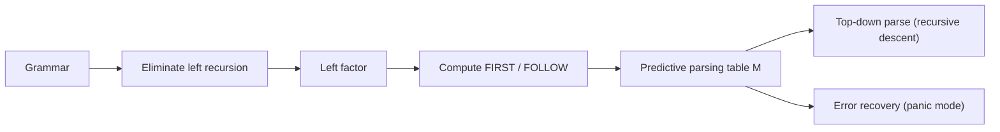
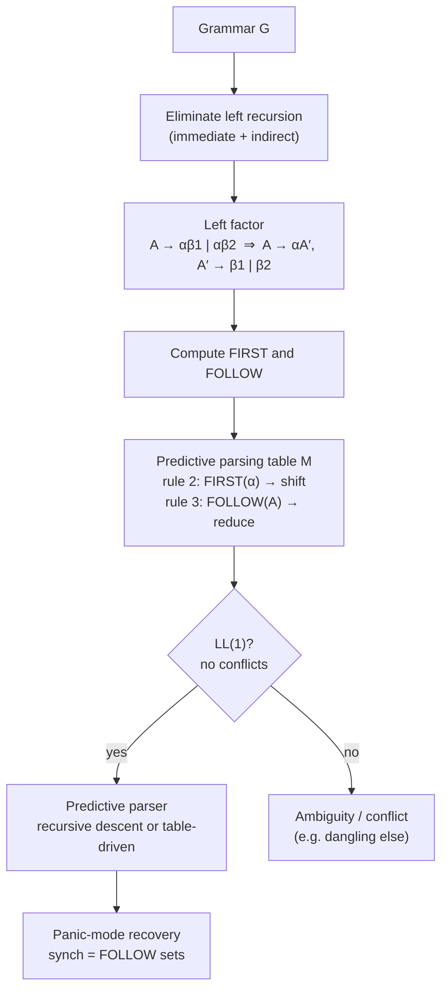

x
# LL(1) Parsing & Predictive Parsers

> [!info] Lecture — 2026-10-04
> CS424 Programming Language Design & Semantics — **Syntax Analysis: Review (LL Review)**
> Lecturer: Hao Wu · Computer Science Department, Maynooth University
> Source: `LL.pdf` (Beamer deck, 40 slides, Semester 1 (Fall) 2026)

This is a **review** lecture: it revisits the CS310 material (left-recursion elimination, left factoring, FIRST/FOLLOW) and then rebuilds it from the top-down-parsing side. It ends where the next two lectures begin: **LR parsing**.



---

## Left Recursion

The procedure taught in CS310 eliminates all **immediate** left recursion, but *not* left recursion that involves a derivation of **two or more steps**.

> [!example] Non-immediate left recursion
> ```text
> S → Aa | b
> A → Ac | Sd | ε
> ```
> `S` is left-recursive because $S \Rightarrow Aa \Rightarrow Sda$ — but it is **not** *immediate* left recursive.

> [!important] Why it matters
> A top-down (LL) parser expands the **leftmost** nonterminal first. If the leftmost expansion can produce the same nonterminal again, the parser loops forever. LR parsers have no such problem (see [[2026-10-07 - LR Parsing & Shift-Reduce Parsing]]).

### Algorithm for Eliminating Left Recursion

```
Input : Grammar G with no cycles or ε-productions.
Output: An equivalent grammar with no left recursion.

Arrange the nonterminals in some order A1, A2, ..., An.
for i = 1 to n do {
    for j = 1 to i − 1 do {
        replace each production of the form Ai → Aj γ
        by the production Ai → δ1 γ | δ2 γ | ... | δk γ
        where Aj → δ1 | δ2 | ... | δk are all the current Aj-productions }
    eliminate the immediate left recursion among the Aj-productions. }
```

### Worked Example

```
S → Aa | b
A → Ac | Sd | ε
```

**Step 1 — substitute (j = 1, A1 = S, A2 = A):**

```
S → Aa | b            (unchanged, A is not substituted into S yet)
A → Ac | Sd | ε   ⇒   A → Ac | Aad | bd | ε
```

**Step 2 — eliminate immediate left recursion in `A`:**

```
S → Aa | b
A → bdA | A′
A′ → cA | adA | ε
```

- `A → Ac | Aad` is immediate left recursion → factor out the common prefix `A`: `A → A(ad) | bd | ε`.
- New nonterminal `A′` takes the recursive part: `A′ → cA | adA | ε`.

> [!note] Reading the result
> `A` now expands to a (possibly empty) string of `A`s followed by `bd`/`ε`; `A′` is the tail. The grammar is left-recursion free and generates the same language.

---

## Left Factoring

Left factoring is a grammar transformation that produces a grammar suitable for **predictive parsing**.

> **Basic idea:** when it is not clear which of two alternative productions to use to expand a nonterminal `A`, rewrite the `A`-productions so that the decision is *deferred* until enough input has been seen.

```
stmt → if expr then stmt
      | if expr then stmt else stmt
```

### General Rule

If $A \to \alpha\beta_1 \mid \alpha\beta_2$ and the input begins with a non-empty string derived from $\alpha$, we cannot tell whether to expand `A` to $\alpha\beta_1$ or $\alpha\beta_2$. Defer the decision by expanding $A \to \alpha A′$, and after the $\alpha$-derived input is seen, expand $A′$:

$$
\begin{aligned}
A &\to \alpha A'\\
A' &\to \beta_1 \mid \beta_2
\end{aligned}
$$

### Example — the dangling-else problem

```
S → iEtS | iEtSeS | a
E → b
```

Left-factored:

```
S → iEtSS′ | a
S′ → eS | ε
E → b
```

- We may expand `S` to `iEtSS′` on input `i` and wait until `iEtS` has been seen to decide whether to expand `S′` to `eS` or to `ε`.
- **Both grammars are still ambiguous**, and on input `e` it is not clear which alternative for `S′` should be chosen.
- A far more advanced method for top-down parsing is needed → this is exactly where the LL(1) table becomes multi-valued (see [LL(1) Grammars](#ll1-grammars) below).

---

## Recursive-Descent Parsing

> In general, **top-down parsing** can be viewed as an attempt to find a **leftmost derivation** for an input string.
> Equivalently, it constructs a parse tree for the input starting from the root, creating the nodes in **preorder**.

```
S → cAd
A → ab | a
```

Build a parse tree for the input string $w = cabd$:

```
S ──► c A d
      │
      ├──► a b        (choose A → ab: matches "ab")
      └──► a          (A → a: input is "a")
```

### Problem: Backtracking

With $w = cad$ the parser must try `A → ab` first, discover the mismatch at `b`, and then backtrack to `A → a`.

- **Backtracking** = the parser makes repeated scans of the input → dramatically slows down parsing.
- In general, backtracking is **rarely needed** to parse programming-language constructs.

### Predictive Parsers

By carefully writing a grammar (eliminating left recursion, left factoring) we can obtain a grammar that is parsed by a recursive-descent parser that needs **no backtracking**.

> Given a symbol $\alpha$ (current input token) and the nonterminal `A` to be expanded, we must know **which one** of the alternatives of $A \to \alpha_1 \mid \alpha_2 \mid \cdots \mid \alpha_n$ to choose — *deterministically*.

```
stmt → if expr then stmt else stmt
      | while expr do stmt
      | begin stmt list end
```

The keywords `if`, `while` and `begin` always tell us which alternative is the only one that could possibly succeed — the classic LL(1) situation.

### Transition Diagrams

Just like for the lexical analyser. Construction procedure:

1. Eliminate any left recursions from the grammar, and left factor the grammar.
2. For each nonterminal `A`:
   - create an **initial** and a **final (return)** state;
   - for each production $A \to X_1 X_2 \dots X_n$, create a path from the initial to the final state, with edges labelled $X_1 X_2 \dots X_n$.

```
E → TE′
E′ → +TE′ | ε
T → FT′
T′ → ∗FT′ | ε
F → (E) | id
```

### Nonrecursive Predictive Parsing

It is possible to build a **nonrecursive** predictive parser by maintaining a stack *explicitly*, rather than implicitly via recursive calls.

- The key issue: **how to determine the production to be applied for a nonterminal.**
- Answer: with the **FIRST / FOLLOW** sets, which fill in a *predictive parsing table*.

---

## FIRST and FOLLOW

> [!important] Two functions, one table
> The construction of a predictive parser is based on two functions, `FIRST` and `FOLLOW`, associated with a grammar `G`. These functions let us fill in the entries of the **predictive parsing table** for `G`.
> The set of tokens yielded by `FOLLOW` can also be used as **synchronising tokens** during panic-mode error recovery.

### Computation of FIRST

Rules for computing the FIRST set of a symbol `X` in grammar `G`:

1. If `X` is a **terminal**, then $\text{FIRST}(X) = \{X\}$.
2. If $X \to \varepsilon$ is a production, then add $\varepsilon$ to $\text{FIRST}(X)$.
3. If `X` is a **nonterminal** and $X \to Y_1 Y_2 \dots Y_k$ is a production, then place $\alpha$ in $\text{FIRST}(X)$ if for some `i`, $\alpha \in \text{FIRST}(Y_i)$, and $\varepsilon$ is in all of $\text{FIRST}(Y_1), \dots, \text{FIRST}(Y_{i-1})$; that is $Y_1 \dots Y_{i-1} \Rightarrow^* \varepsilon$. If $\varepsilon$ is in $\text{FIRST}(Y_j)$ for all $j = 1, 2, \dots, k$, then add $\varepsilon$ to $\text{FIRST}(X)$.

> **Rule 3 in plain English:** take the FIRST sets of the symbols on the right-hand side, in order, stopping at the first one that does **not** contain ε; if all of them can derive ε, then ε ∈ FIRST(X) too.

**Example:**

```
S → AB
A → a | ε
B → b
```

$$
\begin{aligned}
\text{FIRST}(S) &= \text{FIRST}(A) \cup \text{FIRST}(B) = \{a, b, \varepsilon\}\\
\text{FIRST}(A) &= \{a, \varepsilon\}\\
\text{FIRST}(B) &= \{b\}
\end{aligned}
$$

### Computation of FOLLOW

For all nonterminals `A`:

1. Place `$` in $\text{FOLLOW}(S)$, where `S` is the start symbol and `$` is the **input right endmarker**.
2. If there is a production $A \to \alpha B \beta$, then everything in $\text{FIRST}(\beta)$ **except ε** is placed in $\text{FOLLOW}(B)$.
3. If there is a production $A \to \alpha B$, or a production $A \to \alpha B\beta$ where $\text{FIRST}(\beta)$ contains ε, then everything in $\text{FOLLOW}(A)$ is in $\text{FOLLOW}(B)$.

> [!tip] Rule 2 vs Rule 3 — the distinction that matters
> * **Rule 2** = the nonterminal is followed by something *in the same production* → take $\text{FIRST}(\beta)\setminus\{\varepsilon\}$.
> * **Rule 3** = the nonterminal is followed by something that can follow `A` *itself* → copy $\text{FOLLOW}(A)$.
>
> Watch the position of the nonterminal: in $S \to iEtSS'$, the nonterminal `S` is followed by `S′`, so $\text{FIRST}(S′)\setminus\{\varepsilon\}$ goes into $\text{FOLLOW}(S)$ — **not** FIRST(S).

**Example I**

```
S → AcB
A → aA | ε
B → bBS | ε
```

$$
\begin{aligned}
\text{FIRST}(S) &= \{a, c, \varepsilon\} &&\text{(since } A \to \varepsilon,\ c \text{ could also be first)}\\
\text{FIRST}(A) &= \{a, \varepsilon\}, \quad \text{FIRST}(B) = \{b, \varepsilon\}\\
\text{FOLLOW}(S) &= \{\$\}\\
\text{FOLLOW}(A) &= \{c\}\\
\text{FOLLOW}(B) &= \text{FIRST}(S) \cup \{\$\} = \{a, c, \$\}
\end{aligned}
$$

- `FOLLOW(A) = {c}` — in `S → AcB`, `A` is followed by the terminal `c`.
- `FOLLOW(B) = {a, c, $}` — in `B → bBS`, `B` is followed by `S`, so FIRST(S) − {ε} is included; and `B` sits at the end of `S → AcB`, so `$` comes along via FOLLOW(S).

**Example II**

```
T → R | aTc
R → bR | ε
```

$$
\text{FIRST}(T) = \{b, a, \varepsilon\}, \qquad \text{FIRST}(R) = \{b, \varepsilon\}
$$
$$
\text{FOLLOW}(T) = \text{FOLLOW}(R) \cup \{c\} = \{c, \$\}, \qquad \text{FOLLOW}(R) = \{c, \$\}
$$

- To see why `c` ∈ FOLLOW(R), consider the derivation: $T \Rightarrow aTc \Rightarrow aRc$.

**Example III**

```
S → AB
A → Ca | ε
B → CB′
B′ → aACB′ | ε
C → b | ε
```

$$
\begin{aligned}
\text{FIRST}(S) &= \{a, b, \varepsilon\}, \quad \text{FIRST}(B) = \{a, b, \varepsilon\}\\
\text{FIRST}(B') &= \{a, \varepsilon\}, \quad \text{FIRST}(C) = \{b, \varepsilon\}\\
\text{FOLLOW}(S) &= \text{FOLLOW}(B) = \{\$\}\\
\text{FOLLOW}(A) &= \text{FIRST}(B) \cup \text{FIRST}(C) \cup \text{FIRST}(B') \cup \{\$\}\setminus\{\varepsilon\} = \{a, b, \$\}\\
\text{FOLLOW}(B') &= \text{FOLLOW}(B) = \{\$\}\\
\text{FOLLOW}(C) &= \{a\} \cup \{\$\} = \{a, \$\}
\end{aligned}
$$

- To see why `$` ∈ FOLLOW(C), consider the derivation: $S \Rightarrow AB \Rightarrow ACB \Rightarrow AC$.

---

## Predictive Parsing Table

We can now construct a parsing table for a given grammar `G`:

```
Input : A grammar G
Output: A parsing table M
Algorithm:
 1. For each production A → α, do steps 2 and 3
 2. For each terminal a in FIRST(α), add A → α to M[A, a].
 3. If ε is in FIRST(α), add A → α to M[A, b] for each terminal b in FOLLOW(A).
    If ε is in FIRST(α) and $ is in FOLLOW(A), add A → α to M[A, $].
```

> To fully understand FIRST, FOLLOW and this algorithm, you need to think about **why** we need these rules.

### Full Example

```
E → E + T | T
T → T ∗ F | F
F → (E) | id
```

**3 steps:** (1) eliminate all left-recursive structures; (2) calculate FIRST and FOLLOW for each nonterminal; (3) build the parsing table `M`.

**1. Eliminate left recursion:**

```
E → TE′
E′ → +TE′ | ε
T → FT′
T′ → ∗FT′ | ε
F → (E) | id
```

**2. FIRST and FOLLOW:**

| Set | Value | | Set | Value |
|---|---|---|---|---|
| FIRST(E) | {(, id} | | FOLLOW(E) | {), $} |
| FIRST(T) | {(, id} | | FOLLOW(T) | {+, ), $} |
| FIRST(F) | {(, id} | | FOLLOW(T′) | {+, ), $} |
| FIRST(E′) | {+, ε} | | FOLLOW(F) | {∗, +, ), $} |
| FIRST(T′) | {∗, ε} | | FOLLOW(E′) | {), $} |

**3. Table construction:**

| | `id` | `+` | `∗` | `(` | `)` | `$` |
|---|---|---|---|---|---|---|
| **E** | E → TE′ | | | E → TE′ | | |
| **E′** | | E′ → +TE′ | | | E′ → ε | E′ → ε |
| **T** | T → FT′ | | | T → FT′ | | |
| **T′** | | T′ → ε | T′ → ∗FT′ | | T′ → ε | T′ → ε |
| **F** | F → id | | | F → (E) | | |

> We add `E′ → ε` to the entries `M[E′, )]` and `M[E′, $]` since FIRST(E′) contains the empty string ε. In other words, a parser can see `)` and `$` **without actually reading anything** while parsing E′.

---

## LL(1) Grammars

> **LL(1):** the first “L” stands for **scanning the input from left to right**, the second “L” stands for **producing a leftmost derivation**, and the “1” for using **one input symbol of lookahead** at each step to make parsing-action decisions.

It can be shown that the table-construction algorithm produces, for every LL(1) grammar `G`, a parsing table that parses **all and only** the sentences of `G`.

> [!important] No ambiguous or left-recursive grammar can be LL(1).
> A grammar `G` is **LL(1)** iff whenever $A \to \alpha \mid \beta$ are two distinct productions of `G` the following conditions hold:
> 1. For no terminal `a` do both $\alpha$ and $\beta$ derive strings beginning with `a`.
> 2. At most one of $\alpha$ and $\beta$ can derive ε.
> 3. If $\beta \Rightarrow^* \varepsilon$, then $\alpha$ does not derive any string beginning with a terminal in $\text{FOLLOW}(A)$.

**Example — the grammar above is LL(1):** `E → TE′`, `E′ → +TE′ | ε`, `T → FT′`, `T′ → ∗FT′ | ε`, `F → (E) | id` — and its table (above) has exactly one entry per cell.

### Where the table breaks: the dangling-else grammar

```
S → iEtSS′ | a
S′ → eS | ε
E → b
```

$$
\begin{aligned}
\text{FIRST}(S) &= \{i, a\}, \quad \text{FIRST}(S') = \{e, \varepsilon\}, \quad \text{FIRST}(E) = \{b\}\\
\text{FOLLOW}(S) &= \text{FIRST}(S') \cup \{\$\} = \{e, \$\}\\
\text{FOLLOW}(S') &= \text{FOLLOW}(S) = \{e, \$\}\\
\text{FOLLOW}(E) &= \{t\}
\end{aligned}
$$

- `FOLLOW(S) ⊇ {e}` because in `S → iEtSS′` the middle `S` is followed by `S′`, and FIRST(S′) − {ε} = {e}.
- `FOLLOW(S′) = FOLLOW(S)` because `S′` ends the production `S → iEtSS′` (rule 3).

**Parsing table:**

| Nonterminal | `a` | `b` | `e` | `i` | `t` | `$` |
|---|---|---|---|---|---|---|
| **S** | S → a | | | S → iEtSS′ | | |
| **S′** | | | S′ → eS <br> S′ → ε | | | S′ → ε |
| **E** | | E → b | | | | |

> **Why?** Because FOLLOW(S′) = {e, $} and FIRST(S′) = {e, ε}. This grammar is **ambiguous**, and the ambiguity is manifested by a **choice in what production to use when an `e` is seen**: rule 2 fills `M[S′, e] = S′ → eS` while rule 3 (ε ∈ FIRST(S′), e ∈ FOLLOW(S′)) also wants to put `S′ → ε` there.
> We can resolve this ambiguity by choosing **S′ → eS** (the usual “else binds to the nearest if” resolution).

---

## Difficulties

- In general, **there are no universal rules** that can make a multi-valued entry become a single-valued entry **without affecting the language recognised by the parser**.
- The main difficulty: **writing a grammar**.
  - Left-recursion elimination and left factoring are common strategies.
  - However, these techniques make a grammar hard to read and tricky to use for translation purposes.
- Even with these difficulties, **LL(k) parser generators are still very popular** — for example **ANTLR**.
- **A better solution? → LR parsing techniques** (the coming lectures).

---

## Error Recovery

An **error** is detected during predictive parsing when:

- the terminal on top of the stack does not match the next input symbol, or
- a nonterminal `A` is on top of the stack and `a` is the next input symbol — meaning the table entry `M[A, a]` is **empty**.

### Panic-Mode Error Recovery

Based on the idea of **skipping symbols on the input** until a token in a selected set of **synchronising tokens** appears.

**Methods for choosing the synchronising set:**

1. Place all symbols in `FOLLOW(A)` into the synchronising set for nonterminal `A`. Keep skipping tokens until an element of FOLLOW(A) is seen and pop `A` from the stack — it is likely that parsing can continue.
2. Add to the synchronising set of a lower construct the symbols that begin higher constructs. For example, add keywords that begin statements to the synchronising sets for the nonterminals generating expressions.
3. Add symbols in `FIRST(A)` to the synchronising set for nonterminal `A`.
4. If a nonterminal generates ε, then the production deriving ε can be used as a default. This can postpone some error detection, but cannot cause an error to be missed.
5. If a terminal on top of the stack cannot be matched, pop the terminal and issue a message that the terminal was **inserted**, and continue parsing.

### Example — FIRST and FOLLOW as synchronising tokens

```
E → TE′
E′ → +TE′ | ε
T → FT′
T′ → ∗FT′ | ε
F → (E) | id
```

| | `id` | `+` | `∗` | `(` | `)` | `$` |
|---|---|---|---|---|---|---|
| **E** | E → TE′ | | | E → TE′ | synch | synch |
| **E′** | | E′ → +TE′ | | | E′ → ε | E′ → ε |
| **T** | T → FT′ | synch | | T → FT′ | synch | synch |
| **T′** | | T′ → ε | T′ → ∗FT′ | | T′ → ε | T′ → ε |
| **F** | F → id | synch | synch | F → (E) | synch | synch |

> The entries marked `synch` represent the set of synchronisation tokens. For example, FOLLOW(E′) = {), $}, thus we mark entries `M[E′, )]` and `M[E′, $]` as synch.
> *(The table itself shows `E′ → ε` in those two cells — the ε-production wins over the synch marker; the `synch` cells for `E` are the ones at `)` and `$`, matching FOLLOW(E) = {), $}.)*

### Worked trace on `)id ∗ +id`

```
STACK        INPUT              REMARK
E$           )id ∗ +id          error, skip )
E$           id ∗ +id            okay.
TE′$         id ∗ +id
        after a few steps...
FT′E′$       +id                 error, M[F, +] = synch
T′E′$        +id                 F has been popped.
        continue parsing...
```

---

## Phase-Level Recovery

Panic-mode recovery **does not address the important issues of error messages**. In general, informative error messages have to be supplied by the compiler designer.

> **Phase-level recovery:** implemented by filling the blank entries in the predictive parsing table with **pointers to error routines**.

- An error routine may **change, insert or delete** symbols on the input and issue appropriate error messages.
- It is questionable whether we should permit **alteration of stack symbols** or the **pushing of new symbols** onto the stack.
- However, in any event, we must be sure that there is **no possibility of an infinite loop**. This is usually done by checking that any recovery action eventually results in an input symbol being consumed.

---

## Summary



### Key takeaways

| Concept | Rule of thumb |
|---|---|
| Left recursion | Eliminate it — LL parsers expand the leftmost nonterminal and would loop |
| Left factoring | Defer the `αβ₁` vs `αβ₂` decision until after `α` is read |
| FIRST(X) | Terminals that can *start* a derivation of X (plus ε if X ⇒* ε) |
| FOLLOW(X) | Terminals that can *follow* X in a sentential form; used for the ε-reduce and for `synch` |
| Table entry | `M[A,a]`: FIRST → the production; FOLLOW → the ε-production |
| LL(1) | One token of lookahead, leftmost derivation, left-to-right scan |
| Conflict | Two productions for one cell → the grammar is ambiguous (or needs LR) |

> [!tip] Next lecture
> [[2026-10-07 - LR Parsing & Shift-Reduce Parsing]] — we leave top-down parsing behind and build **bottom-up (shift-reduce) LR parsing**, which handles left recursion and a larger class of grammars.
