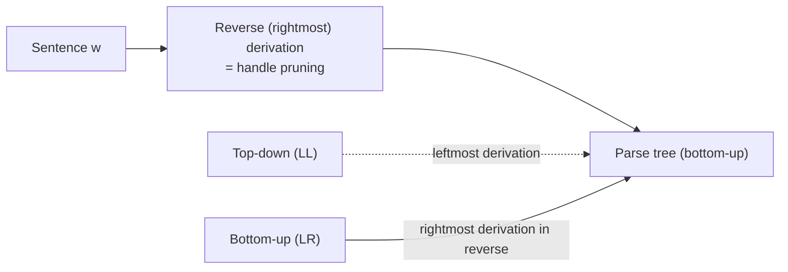
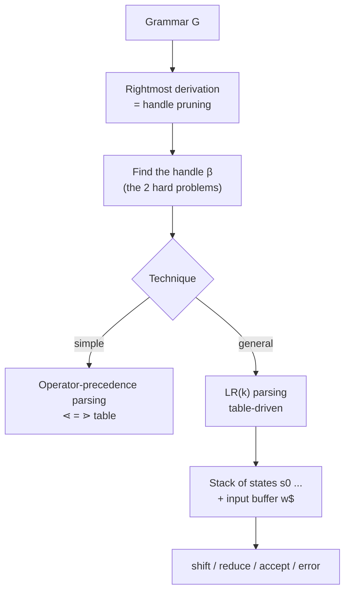

# LR Parsing & Shift-Reduce Parsing

> [!info] Lecture — 2026-10-07
> CS424 Programming Language Design & Semantics — **Syntax Analysis: Bottom-Up Parsing (1)**
> Lecturer: Hao Wu · Computer Science Department, Maynooth University
> Source: `LR.pdf` (Beamer deck, 21 slides, Semester 1 (Fall) 2026)

Last lecture we built **top-down** (predictive / LL) parsers. This lecture introduces the **bottom-up** alternative: *shift-reduce parsing*, and the **LR** family. The deck ends with operator-precedence parsing as a "cheap" bottom-up method.



---

## Shift-Reduce Parsing — the Idea

We introduce a general style of **bottom-up** syntax analysis known as **shift-reduce parsing**. LR parsing is a much more general method of shift-reduce parsing — especially about **how to construct a parsing table**, *regardless of left-recursive structures*.

```
S → aABe
A → Abc | b
B → d
```

Sentence: **abbcde**. Idea: start from the sentence `abbcde` all the way back to the root of our tree (**bottom-up**).

### Derivation (read it backwards)

```
abbcde ⇒ aAbcde ⇒ aAde ⇒ aABe ⇒ S
```

What just happened?

1. We choose the **leftmost `b`** and replace it by `A` (because `A → b`) → `aAbcde`.
2. We now choose the substring `Abc`, and replace it by `A` since `A → Abc` → `aAde`.
3. Since `B → d`, we replace `d` by `B` → `aABe`.
4. Finally, we can simply replace `aABe` by `S`.

### Reduction

> Every time we replace a substring `t` with some non-terminal symbol `A`, such a replacement is called a **reduction**.

We reduce a sequence of terminals back to some nonterminal `A` until we reach the start symbol `S`. This process is called **bottom-up parsing**.

### Handle

> **Formally**, a *handle* of a right-sentential form $\gamma$ is a production $A \to \beta$ and a position of $\gamma$ where the string $\beta$ may be found and replaced by `A` to produce the **previous** right-sentential form in a rightmost derivation of $\gamma$.

$$
S = \Rightarrow^* \alpha A w = \Rightarrow^* \alpha \beta w
$$

then $A \to \beta$ in the position following $\alpha$ is a **handle** of $\alpha\beta w$. The string `w` to the right of the handle contains only terminal symbols.

Example: `abbcde ⇒ aAbcde` — the handle is `b` and the production is `A → b`.

---

## Ambiguity and Precedence

```
E → E + E
E → E ∗ E
E → (E)
E → id
```

The rightmost derivation for `id + id ∗ id` (see whiteboard in the deck) gives `∗` a **higher precedence** than `+`.

Because `G` is **ambiguous**, there is another rightmost derivation of the same string:

```
E ⇒ E ∗ E
  ⇒ E ∗ id
  ⇒ E + E ∗ id
  ⇒ E + id ∗ id
  ⇒ id + id ∗ id
```

> We prefer the **first** derivation because it gives `∗` a higher precedence than `+`.
> The two rightmost derivations here are analogues of the two leftmost derivations from the LL(1) lecture.

---

## Handle Pruning

A rightmost derivation (in reverse) can be obtained by **"handle pruning"**:

1. Start with a string of terminals `w` that we wish to parse. If `w` is a sentence of the grammar at hand, then $w = \gamma_n$, where $\gamma_n$ is the `n`-th right-sentential form of some as-yet-unknown rightmost derivation.
2. Locate the handle $\beta_n$ in $\gamma_n$ and replace $\beta_n$ by the left side of some production $A_n \to \beta_n$ to obtain the $(n-1)$-st right-sentential form $\gamma_{n-1}$.
3. Repeat until the right-sentential form consists only of the start symbol `S`.

$$
S = \gamma_0 \Rightarrow \gamma_1 \Rightarrow \gamma_2 \Rightarrow \cdots \Rightarrow \gamma_{n-1} \Rightarrow \gamma_n = w
$$

### Example

| Right Sentential Form | Handle | Reducing Production |
|---|---|---|
| id₁ + id₂ ∗ id₃ | id₁ | E → id |
| E + id₂ ∗ id₃ | id₂ | E → id |
| E + E ∗ id₃ | id₃ | E → id |
| E + E ∗ E | E ∗ E | E → E ∗ E |
| E + E | E + E | E → E + E |
| E | | |

This is just the reverse of the derivation from earlier in the lecture.

---

## Left Recursion & Right Recursion

- We know that **LL(k) parsers cannot work with a grammar that has left recursion(s)** — the parser expands the leftmost nonterminal and would loop.
- For **LR(k) parsers**, they **can handle a grammar that contains both left and right recursion structures**.

> [!important] This is the main selling point of LR
> The LR family recognises a **strictly larger** class of grammars than the LL family, and it never needs backtracking.

---

## The Implementation: A Stack

Understanding shift-reduce parsing is quite easy, but **two main problems** must be solved if we are to parse by handle pruning:

1. **Locate** the substring to be reduced in a right-sentential form.
2. **Determine what production rule to choose**, if there are more than one production rules. *(sounds familiar?)*

We deal with these two problems in the following lectures; for now we focus on the **implementation** of a shift-reduce parser with a stack.

### The 4 Operations

| Operation | Meaning |
|---|---|
| **Shift** | The next input symbol is placed onto the top of the stack. |
| **Reduce** | Locate the left end of the handle within the stack and decide what nonterminal to replace the handle. |
| **Accept** | Parsing is successfully completed. |
| **Error** | The parser discovers that a syntax error has occurred and calls an error recovery routine. |

### Example Trace

```
Stack          Input                Action
$              id₁ + id₂ ∗ id₃ $    shift
$id₁           + id₂ ∗ id₃ $        reduce by E → id
$E             + id₂ ∗ id₃ $        shift
$E +           id₂ ∗ id₃ $          shift
$E + id₂       ∗ id₃ $              reduce by E → id
$E + E         ∗ id₃ $              shift
$E + E ∗       id₃ $                shift
$E + E ∗ id₃   $                    reduce by E → id
$E + E ∗ E     $                    reduce by E → E ∗ E
$E + E         $                    reduce by E → E + E
$E             $                    accept
```

---

## LR Parsing

```
Input : An input string w and an LR parsing table with functions
        action and goto for a grammar G.
Output: If w ∈ L(G), a bottom-up parse for w; otherwise an error indication.
Method :
  Initially, the parser has s0 on its stack, where s0 is the initial state,
  and w$ in the input buffer. The parser consults the table each time to
  make a decision on the current input symbol (shift or reduce).
```

> An LR parser has an explicit **stack of states** (not just symbols) — that is why the trace below shows `0T 2 ∗ 7 id 5` rather than a plain symbol stack.

### The Grammar

```
(1)  E → E + T
(2)  E → T
(3)  T → T ∗ F
(4)  T → F
(5)  F → (E)
(6)  F → id
```

### The Parsing Table

| State | `id` | `+` | `∗` | `(` | `)` | `$` | **E** | **T** | **F** |
|---|---|---|---|---|---|---|---|---|---|
| 0 | s5 | | | s4 | | | 1 | 2 | 3 |
| 1 | | s6 | | | | acc | | | |
| 2 | | r2 | s7 | | r2 | r2 | | | |
| 3 | | r4 | r4 | | r4 | r4 | | | |
| 4 | s5 | | | s4 | | | 8 | 2 | 3 |
| 5 | | r6 | r6 | | r6 | r6 | | | |
| 6 | s5 | | | s4 | | | 9 | 3 | |
| 7 | s5 | | | s4 | | | | | 10 |
| 8 | | s6 | | | s11 | | | | |
| 9 | | r1 | s7 | | r1 | r1 | | | |
| 10 | | r3 | r3 | | r3 | r3 | | | |
| 11 | | r5 | r5 | | r5 | r5 | | | |

- `sn` = **shift** the input symbol and go to state `n`.
- `rn` = **reduce** by production `n` (e.g. `r3` = reduce by `T → T ∗ F`).
- `acc` = accept.
- Blank = error.

### Example Trace — input `id ∗ id + id$`

| Stack | Input | Action |
|---|---|---|
| 0 | id ∗ id + id$ | shift |
| 0 id 5 | ∗ id + id$ | reduce by F → id |
| 0 F 3 | ∗ id + id$ | reduce by T → F |
| 0 T 2 | ∗ id + id$ | shift |
| 0 T 2 ∗ 7 | id + id$ | shift |
| 0 T 2 ∗ 7 id 5 | + id$ | reduce by F → id |
| 0 T 2 ∗ 7 F 10 | + id$ | reduce by T → T ∗ F |
| 0 T 2 | + id$ | reduce by E → T |
| 0 E 1 | + id$ | shift |
| 0 E 1 + 6 | id$ | shift |
| 0 E 1 + 6 id 5 | $ | reduce by F → id |
| 0 E 1 + 6 F 3 | $ | reduce by T → F |
| 0 E 1 + 6 T 9 | $ | reduce by E → E + T |
| 0 E 1 | $ | reduce by **accept** |

> The two open questions from earlier are now answered by the table: the *state* encodes "where in the grammar we are", so it locates the handle **and** picks the production. That table is built mechanically — next lecture.

---

## Operator-Precedence Parsing — Basics

A much simpler bottom-up technique: instead of a full LR table, use **precedence relations** between terminals.

### The Relations

| Relation | Meaning |
|---|---|
| $a \lessdot b$ | `a` **yields precedence to** `b` |
| $a = b$ | `a` **has the same precedence as** `b` |
| $a \gtrdot b$ | `a` **takes precedence over** `b` |

For example $+ \lessdot *$ simply means that `∗` has the higher precedence.

### The Precedence Table

| | `id` | `+` | `∗` | `$` |
|---|---|---|---|---|
| **id** | — | ⋗ | ⋗ | ⋗ |
| **+** | ⋖ | ⋗ | ⋖ | ⋗ |
| **∗** | ⋖ | ⋗ | ⋗ | ⋗ |
| **$** | ⋖ | ⋖ | ⋖ | — |

*(The `(id, id)` cell is left blank in the deck; the standard table has `id ⋗ id`.)*

### Finding the Handle

Given a string, e.g. `$id + id ∗ id$`, we insert the relations using the table above:

```
$ ⋖ id ⋗ + ⋖ id ⋗ ∗ ⋖ id ⋗ $
```

The handle can be found by the following process:

1. Scan the string from the **left end** until the first `⋗` is encountered.
2. Scan **backwards** (to the left) over any `=`'s until a `⋖` is encountered.
3. The handle contains everything to the **left** of the first `⋗` and to the **right** of the `⋖` encountered in step 2, including any intervening or surrounding nonterminals.

### Example

First, reduce every `id` to `E`:

```
E + E ∗ E
```

Then "remove" all the nonterminals and insert the operator-precedence relations:

```
$ ⋖ + ⋖ ∗ ⋗ $
```

> The nonterminals can be kept on the stack of a shift-reduce parser.

---

## Summary



### Key takeaways

| Concept | Point |
|---|---|
| Bottom-up | Build the parse tree from the leaves up by reversing a rightmost derivation |
| Reduction | Replacing a substring `t` by a nonterminal `A` |
| Handle | The `β` of a production `A → β` in the current right-sentential form — the unit that gets reduced next |
| LL vs LR | LL = leftmost derivation + 1 token lookahead; LR = rightmost derivation in reverse + `k` tokens lookahead |
| Recursion | LL cannot cope with left recursion; LR handles left **and** right recursion |
| LR table | `action` (shift/reduce/accept) + `goto` (nonterminal transitions) — the mechanism that removes both hard problems |

> [!tip] Next lecture
> [[2026-10-12 - SLR Parsing & LR Table Construction]] — how do we *build* that LR table? **closure**, **goto**, and the **SLR** algorithm over LR(0) item sets.
