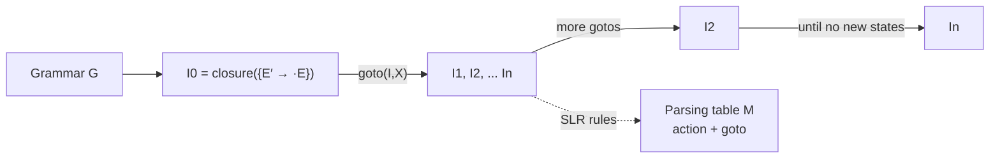
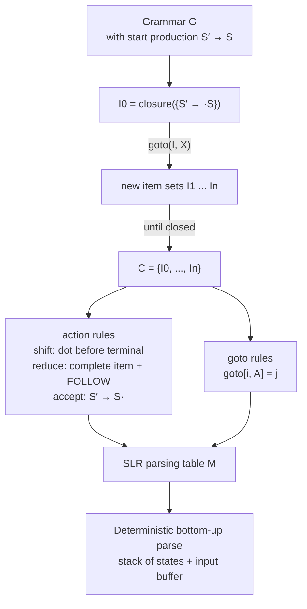

# SLR Parsing & LR Table Construction

> [!info] Lecture — 2026-10-12
> CS424 Programming Language Design & Semantics — **Syntax Analysis: Bottom-Up Parsing (2)**
> Lecturer: Hao Wu · Computer Science Department, Maynooth University
> Source: `LR_1.pdf` (Beamer deck, 21 slides, Semester 1 (Fall) 2026–2027)

Last lecture we saw the LR **table** and used it. This lecture answers the obvious question: **how is that table built?** The answer is two operations — `closure` and `goto` — applied to sets of **LR(0) items**, giving the **SLR** (Simple LR) algorithm.



---

## LR Parsing — Recap

> **LR(k) parsing technique:** the “L” is for **left-to-right scanning** of the input. The “R” for constructing a **rightmost derivation in reverse**, and the `k` for the **number of input symbols of lookahead** used in making parsing decisions. When `k` is omitted, `k` is assumed to be **1**.

### Why LR is attractive

- LR parsers can be constructed to recognize **virtually all programming language constructs** for which a context-free grammar can be written.
- It is the **most general nonbacktracking shift-reduce parsing method** known.
- The class of grammars parsed by LR is a **proper superset** of the class of grammars parsed with predictive parsers.
- An LR parser can **detect a syntactic error as soon as it is possible** to do so on a left-to-right scan of the input.

> [!warning] Main drawback
> **Too much work to construct a table by hand.** — which is exactly what this lecture automates.

### The Grammar and Its Table (from last lecture)

```
(0)  E′ → E
(1)  E  → E + T
(2)  E  → T
(3)  T  → T ∗ F
(4)  T  → F
(5)  F  → ( E )
(6)  F  → id
```

| State | `id` | `+` | `∗` | `(` | `)` | `$` | **E** | **T** | **F** |
|---|---|---|---|---|---|---|---|---|---|
| 0 | s5 | | | s4 | | | 1 | 2 | 3 |
| 1 | | s6 | | | | acc | | | |
| 2 | | r2 | s7 | | r2 | r2 | | | |
| 3 | | r4 | r4 | | r4 | r4 | | | |
| 4 | s5 | | | s4 | | | 8 | 2 | 3 |
| 5 | | r6 | r6 | | r6 | r6 | | | |
| 6 | s5 | | | s4 | | | 9 | 3 | |
| 7 | s5 | | | s4 | | | | | 10 |
| 8 | | s6 | | | s11 | | | | |
| 9 | | r1 | s7 | | r1 | r1 | | | |
| 10 | | r3 | r3 | | r3 | r3 | | | |
| 11 | | r5 | r5 | | r5 | r5 | | | |

---

## Parsing Table Construction

> **Question:** How do we construct the parsing table?
> **Answer:** We need two functions — **closure** and **goto**.

| Function | Role |
|---|---|
| **closure** | Works out **all possible production rules** to be used during the parsing, based on the current input symbol. |
| **goto** | Decides that **if we see a symbol, whether we should shift or reduce to a nonterminal**. It is just like building a **transition table for a DFA**. |

> [!note] LL and LR share a common idea
> Work out all possible symbol(s) to be seen based on the current input symbol **before parsing starts**. This eliminates non-determinism during the parsing. However, the program must **compute a table first** — traded off here is **space**. We want our parsing process to be deterministic (fast), so we sacrifice space.

### LR(k) vs LL(k)

A significant difference between LL and LR grammars:

- For a grammar to be **LR(k)**, we must be able to recognise the **occurrence of the right side** of a production, having seen **all** of what is derived from that right side, with `k` input symbols of lookahead.
- For a grammar to be **LL(k)**, we must be able to recognise the **use** of a production seeing **only the first `k` symbols** of what its right side derives.

> **Thus, LR grammars can describe more languages than LL grammars.**

---

## The Closure Operation

> If `I` is a set of items for a grammar `G`, then **closure(I)** is the set of items constructed from `I` by the following two rules:
>
> 1. Initially, **every item in `I` is added** to closure(I).
> 2. If $A \to \alpha \cdot B\beta$ is in closure(I) and $B \to \gamma$ is a production, then add the item $B \to \cdot\gamma$ to `I`, if it is not already there. **Apply this rule until no more new items can be added** to closure(I).

> [!tip] In words
> If the dot has a **nonterminal** immediately to its right, we must be prepared to derive that nonterminal — so add **all** productions of that nonterminal with the dot at the far left. Repeat until nothing new appears.

### Example

`I` is the set of the one item `{E′ → ·E}`:

```
(0)  E′ → E
(1)  E  → E + T
(2)  E  → T
(3)  T  → T ∗ F
(4)  T  → F
(5)  F  → ( E )
(6)  F  → id
```

then closure(I) contains the items:

```
E′ → ·E
E  → ·E + T
E  → ·T
T  → ·T ∗ F
T  → ·F
F  → ·(E)
F  → ·id
```

Why:

- `E′ → ·E` is put in closure(I) by **rule 1**.
- Since there is an `E` immediately to the right of a dot, by **rule 2** we add the `E`-productions with dots at the left end: `E → ·E + T` and `E → ·T`.
- Now there is a `T` immediately to the right of a dot, so we add `T → ·T ∗ F` and `T → ·F`.
- Next the `F` to the right of a dot forces `F → ·(E)` and `F → ·id` to be added.

---

## The Goto Operation

> **goto(I, X)**, where `I` is a set of items and `X` is a grammar symbol (it could be a terminal or a nonterminal).
>
> **goto(I, X)** is defined to be the **closure** of the set of all items $[A \to \alpha X \cdot \beta]$ such that $[A \to \alpha \cdot X \beta]$ is in `I`.

> Thus, the idea is that if `I` is the set of items that are valid for some **viable prefix** `γ`, then goto(I, X) is the set of items that are valid for the viable prefix `γX`. *(Just recall your knowledge about DFAs.)*

### Example

If `I` is the set of two items `{E′ → E·}` and `{E → E· +T}`, then **goto(I, +)** consists of:

```
E → E + ·T
T → ·T ∗ F
T → ·F
F → ·(E)
F → ·id
```

We compute goto(I, +) by examining `I` for items with `+` immediately to the right of the dot. `E′ → E·` is **not** such an item, but `E → E· +T` is. We **move the dot over the `+`** to get `{E → E + ·T}` and then compute the **closure** of this set.

---

## Putting It All Together

### I0 — the initial state

```
E′ → ·E
E  → ·E + T
E  → ·T
T  → ·T ∗ F
T  → ·F
F  → ·(E)
F  → ·id
```

### I1, I2, I3

```
I1 :  E′ → E·              I2 :  E → T·              I3 :  T → F·
      E  → E· +T                T → T· ∗F
```

### I4, I5

```
I4 :  F → (·E)             I5 :  F → id·
      E  → ·E + T
      E  → ·T
      T  → ·T ∗ F
      T  → ·F
      F  → ·(E)
      F  → ·id
```

### I6, I7

```
I6 :  E → E + ·T          I7 :  T → T ∗ ·F
      T → ·T ∗ F                F → ·(E)
      T → ·F                    F → ·id
      F → ·(E)
      F → ·id
```

### I8, I9, I10, I11

```
I8 :   F → (E·)            I9 :   E → E + T·         I10:  T → T ∗ F·
       E → E· +T                 T → T· ∗F            I11:  F → (E)·
```

> [!note] Reading the item sets
> An **item** `A → α·β` says: *we have seen `α` and still need `β`*. A **complete** item (`A → α·`) is a candidate for reduction; an item with the dot before a **terminal** gives a shift; an item with the dot before a **nonterminal** triggers `closure`.

---

## SLR Parsing Table

> **SLR** stands for **Simple LR**.

```
Method:
 1. Construct C = {I0, I1, ..., In}, the collection of sets of LR(0) items for G.
 2. State i is constructed from Ii. The parsing actions for state i are
    determined as follows:
      a) If [A → α·aβ] is in Ii and goto(Ii, a) = Ij, then set
         action[i, a] to "shift j". Here a must be a terminal.
      b) If [A → α·] is in Ii, then set action[i, a] to "reduce A → α"
         for all a in FOLLOW(A); here A may not be S′.
      c) If [S′ → S·], then set action[i, $] to "accept".
 3. The goto transitions for state i are constructed for all nonterminals A:
    if goto(Ii, A) = Ij then goto[i, A] = j.
 4. All entries not defined by (2) and (3) are made "error".
 5. The initial state of the parser is the one constructed from the set of
    items containing [S′ → S·].
```

> [!important] The three action rules in plain English
> * **Shift** — the dot sits before a **terminal** `a`: go to `goto(Ii, a)`.
> * **Reduce** — the item is **complete** (`A → α·`): reduce by `A → α` on every terminal in **FOLLOW(A)**.
> * **Accept** — the **start item** `S′ → S·` is complete: accept on `$`.
>
> Everything not covered is an **error** entry.

### Example I — state I0

```
E′ → ·E
E  → ·E + T
E  → ·T
T  → ·T ∗ F
T  → ·F
F  → ·(E)
F  → ·id
```

Consider the item `F → ·(E)`. Since `(` is a **terminal**, we set **action[0, (] = "shift 4"** (consult your DFA). Similarly, we set **action[0, id] = "shift 5"**. *(The complete table is shown earlier in the lecture.)*

### Example II — state I1

```
E′ → E·
E  → E· +T
```

- The first item gives us **action[1, $] = accept**.
- The second yields **action[1, +] = shift 6**.

### Example III — state I2

```
E → T·
T → T· ∗F
```

- The second item yields **action[2, ∗] = shift 7**.
- The first item yields **action[2, $] = action[2, +] = action[2, )] = reduce E → T** (using rule 2b).

> **Why?** Because `E → T·` is a complete item, so we reduce by `E → T` on every terminal in **FOLLOW(E) = {+, ), $}**. *(Check: `E` appears as the left-hand side of `E → E + T`, so `+` follows `E`; `E` appears inside `F → (E)`, so `)` follows `E`; and `E` appears at the end of `E′ → E`, so `$` follows `E`.)*

> [!tip] Consistency check for the whole table
> The reduces in the table line up exactly with the FOLLOW sets of the grammar:
> FOLLOW(E) = {+, ), $} (rows 2, 9), FOLLOW(T) = FOLLOW(F) = {∗, +, ), $} (rows 3, 5, 10, 11).

---

## Summary



### Key takeaways

| Concept | Point |
|---|---|
| LR(0) item | `A → α·β` — what we have seen (`α`) and what we still need (`β`) |
| closure | Add all productions of any nonterminal sitting right of a dot; iterate to fixpoint |
| goto | Move the dot over a symbol `X`, then take the closure — exactly a DFA transition |
| SLR | Simple LR: reduce on **FOLLOW(A)** for complete items; conflicts are possible (→ LR(1) next) |
| Table | `action` (terminals) + `goto` (nonterminals); blank = error |
| Cost | Space for the table is traded for a deterministic, non-backtracking, fast parser |

> [!tip] Next lecture
> **LR(1)** — canonical LR(1) item sets and the reduction of the SLR conflict. SLR is *simple* but not always sufficient; LR(1) always is (at the cost of many more states).
